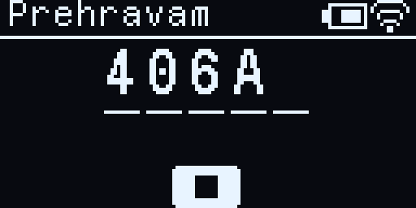

# Hraní písně { #hrani }

1. V `Hlavni menu` vyberte `Prehravac` a stiskněte OK.
2. Zadejte číslo písně číslicemi. Písmeno A–D přidáte tlačítkem nahoru (dolů se vrátíte). Kód `12` a `012` jsou různé písně.
3. Stiskněte OK. Ovladač ukáže `Spoustim` a pak `Prehravam` se slokou.

Zadáte-li neexistující číslo, ovladač ukáže `Neznama` a číslo. Pokud nevíte, jaké písně jsou k dispozici, stiskněte nahoru nebo dolů bez zadaných číslic: otevře se seznam písní.

## Během hry

| Chcete | Stiskněte |
|---|---|
| přidat sloku | doprava (`Opakovat`), OK. Lze opakovat. |
| zastavit | vyberte `Stop` (doleva) a OK |
| jinou píseň | zadejte kód a OK |
| opravit kód | doleva |

Píseň nelze pozastavit; po zastavení začne znovu od začátku.
