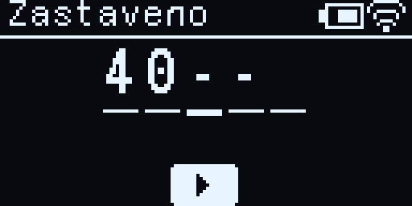
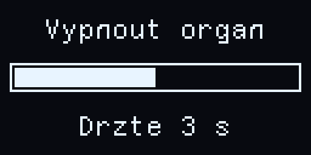

# Hraní písně { #hrani }

1. V `Hlavni menu` vyberte `Prehravac` a stiskněte OK.
2. Zadejte číslo písně číslicemi. Písmeno A–D přidáte tlačítkem nahoru (dolů se vrátíte). Kód `12` a `012` jsou různé písně.
3. Stiskněte OK. Ovladač ukáže `Spoustim` a pak `Prehravam` se slokou.

Zadáte-li neexistující číslo, ovladač ukáže `Neznama` a číslo. Pokud nevíte, jaké písně jsou k dispozici, stiskněte nahoru nebo dolů bez zadaných číslic: otevře se seznam písní.

## Během hry

| Chcete | Stiskněte |
|---|---|
| přidat sloku | doprava (`Opakovat`), OK. Lze opakovat. |
| zastavit | vyberte `Stop` (doleva) a OK |
| jinou píseň | zadejte kód a OK |
| opravit kód | doleva |

Píseň nelze pozastavit; po zastavení začne znovu od začátku.

## Seznam písní na základně

Na základně vyberte `Prehraj`: otevře se seznam písní. Poslední položkou je `Zpet`. Seznam opustíte i dlouhým stiskem enkodéru (kdekoli v seznamu); krátký stisk píseň vybere.

## Nouzové vypnutí varhan { #nouzove-vypnuti }

Když se cokoli vymkne z ruky (visí tóny, hraje špatná píseň), podržte na ovladači tlačítko **MF** na 3 s. Ovladač ukáže `Vypnout organ` / `Drzte 3 s` s ukazatelem postupu. Po 3 s je to **nouzové přerušení**: základna sama okamžitě vypne všechny tóny a varhany (funguje i bez počítače) a pošle příkaz počítači. Počítač zastaví přehrávání písně, ukončí a **uloží** případný záznam (nic se neztratí), zahodí rozdělané stavy a je připraven na novou píseň. Základna na 5 s (nebo do stisku tlačítka) ukáže velkým písmem `Nouzove` / `Preruseno` a vrátí se do hlavní nabídky, ovladač také. Další píseň pak spustíte jako obvykle. Krátký stisk MF dělá dál to, co dřív (doleva), a pustíte-li MF před uplynutím 3 s, nestane se nic.

!!! note
    Starší základna (firmware bez této funkce) příkaz odmítne a varhany se nevypnou. V takovém případě je vypněte v `Nastaveni` základny (`Napajeni varhan`).
