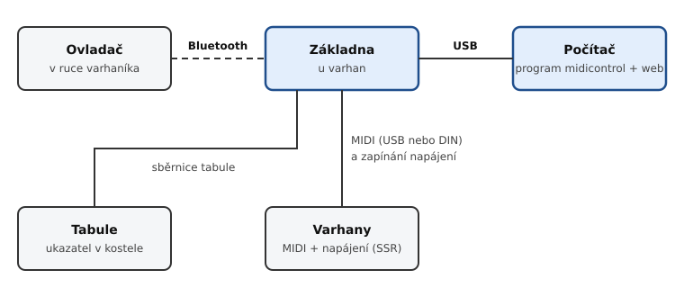

# Úvod

MIDIcontrol je souprava pro ovládání varhan při bohoslužbě. Varhaník na malém ručním **ovladači** zadá číslo písně a stiskne OK. Počítač píseň najde, zapne varhany a přehraje ji. **Tabule** v kostele ukáže číslo písně a sloky. Přehrávání lze zastavit a lze přidat sloku, aniž by varhaník opustil lavici.

## Z čeho se systém skládá { #soucasti }

{ width="90%" }

| Součást | Role |
|---|---|
| **Ovladač** | Ruční jednotka s displejem, číslicovými a směrovými tlačítky, tlačítkem OK a tlačítkem ON/OFF. Zadáte na něm číslo písně a řídíte přehrávání. Napájí ho baterie (nabíjí se přes USB-C). Viz kapitola [Ovladač](ovladac.md). |
| **Základna** | Jednotka u varhan. Spojuje ovladač (Bluetooth), počítač (USB), varhany (MIDI) a tabuli. Spíná napájení varhan. Má displej, enkodér a LED. Viz [Základna](zakladna.md). |
| **Počítač** | Program `midicontrol` hledá písně ve složce, přehrává je a posílá údaje na tabuli. Běží na pozadí. Obsluha jde přes webovou stránku. Viz [Webová stránka](web.md). |
| **Tabule** | Ukazatel v kostele. Sdílí sběrnici se základnou. Viz [Tabule](tabule.md). |
| **Varhany** | Johannus Opus 910 se 42 rejstříky. Hrají přehrávané písně a základna jim spíná napájení. |

Při běžné službě organista používá jen ovladač. Ostatní části běží samy. Webovou stránku používá organista pro kontrolu stavu a pro nastavení rejstříků písní. Instalaci a údržbu řeší správce (kapitola [Pro správce](sprava.md)).

## Pro koho je příručka

Příručka je určena organistovi a správci. Kapitoly [Ovladač](ovladac.md), [Základna](zakladna.md), [Tabule](tabule.md) a [Webová stránka](web.md) popisují jednotlivé části. Kapitola [Typické postupy](postupy.md) vede krok za krokem běžnými situacemi. Když se něco nedaří, hledejte v kapitole [Řešení problémů](problemy.md). Na jednu stránku k vytištění je [Rychlý přehled](tahak.md).

## Číslo písně

Píseň se volí kódem o 1 až 4 číslicích (nejvýše 1999) a s volitelným písmenem A až D, například `406` nebo `406B`. Kódy `12` a `012` jsou různé písně. Podrobnosti viz [Zadání čísla písně](ovladac.md#zadani-pisne).

## O této příručce

Příručka platí pro MIDIcontrol s firmwarem verze TODO: doplnit čísla verzí firmwaru ovladače, základny a programu v počítači. Firmware nemá číslované vydání, zobrazuje jen revizi gitu a větev (stránka `Verze FW`).

Texty na displejích jsou v příručce psány `neproporcionálním písmem` a bez diakritiky, přesně tak, jak se na displeji zobrazují (například `Hlavni menu`). Názvy tlačítek jsou psány velkými písmeny (OK, ON/OFF). Směry nahoru, dolů, doleva a doprava odpovídají směrovým tlačítkům ovladače.

Upozornění v příručce:

!!! danger
    Nebezpečí, které způsobí smrt nebo těžké zranění, pokud mu nezabráníte.

!!! warning
    Nebezpečí, které může způsobit zranění nebo poškození přístroje či jiného zařízení.

!!! note
    Užitečná informace, která nesouvisí s bezpečností.

TODO: Zamýšlené použití, prostředí a předvídatelné nesprávné použití (majitel). TODO: Obsah balení (majitel). TODO: Popisky na panelech a tlačítkách se firmwarem nelze ověřit; zkontrolovat na přístroji.
