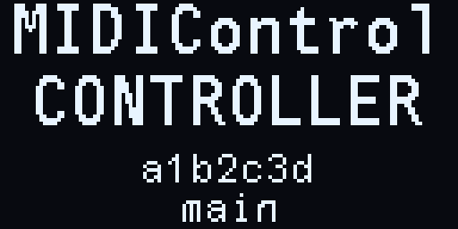
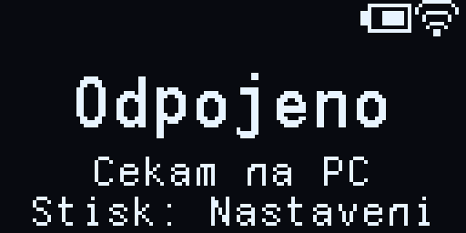
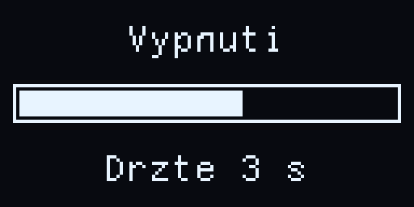

# Začátek

MIDIcontrol přehrává písně na varhanách. Na malém **ovladači** zadáte číslo písně, stisknete OK a počítač píseň přehraje. Ukazatel v kostele ukáže číslo písně a sloky.

{ width="85%" }

| Součást | K čemu je |
|---|---|
| **Ovladač** | Ruční jednotka na baterii. Zadáte na ní číslo písně. |
| **Základna** | Jednotka u varhan. Spojuje ovladač, počítač a varhany a spíná jejich napájení. |
| **Počítač** | Program `midicontrol` hledá písně, přehrává je a nabízí webovou stránku. |

## Po zapnutí { #start }

Zapněte základnu a počítač, pak ovladač tlačítkem ON/OFF. Každé zařízení ukáže na 3 s úvodní obrazovku (`MIDIControl`) a potom hlavní menu.

Dokud některá část chybí, přes menu se ukáže hlášení **Odpojeno**:

| Hlášení | Co znamená | Co udělat |
|---|---|---|
| `Cekam na zakladnu` (ovladač) | Ovladač nevidí základnu. | Zapněte základnu a počkejte. |
| `Cekam na PC` (ovladač i základna) | Základna nevidí počítač. | Zapněte počítač a zkontrolujte USB kabel k základně. |
| `Sparuj ovladac` (základna) | Základna nemá spárovaný ovladač. | Spárujte ho, viz [Nastavení](nastaveni.md#parovani). |

Hlášení **Odpojeno** ukazuje i ikony stavu (spojení a na ovladači baterie nebo nabíjení), takže stav zařízení vidíte i bez menu. Hlášení samo zmizí, jakmile je spojení v pořádku. Pak je ovladač připraven. Napájení varhan zapíná základna sama při první písni, varhany zapínat nemusíte.

Displeje po 30 s zhasnou. První stisk tlačítka jen probudí displej. Ovladač se po 20 minutách bez stisku vypne; ručně ho vypnete podržením ON/OFF na 3 s.

## Vypnutí ovladače { #vypnuti }

Podržte tlačítko ON/OFF. Ovladač ukáže `Vypnuti` / `Drzte 3 s` s ukazatelem postupu; po 3 s se vypne. Pustíte-li tlačítko dřív, nic se nestane. Platí to i při napájení z USB.

