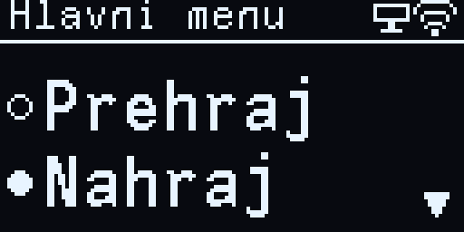

# Nahrávání písně { #nahravani }

Nahrávat lze hru na varhany do souboru. Nahrávku pak můžete použít jako novou píseň ([Nová píseň](nova-pisen.md)).

1. Na základně vyberte v hlavním menu `Nahraj` a stiskněte enkodér. Počítač případně zapne varhany a po několika sekundách začne nahrávat.
2. Hrajte.
3. Znovu vyberte `Nahraj` a stiskněte enkodér. Nahrávání skončí.

Během nahrávání nelze spustit píseň a naopak. Základna zatím neukazuje, že se nahrává, ani že nahrávání selhalo (např. když počítač chybí). Zda nahrávka vznikla, ověříte ve složce nahrávek na počítači.

Nahrávka se uloží do složky `recordings` jako soubor pojmenovaný podle data a času, například `2026-11-21T10:30:00.mid`.
