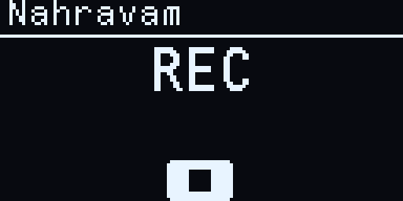

# Nahrávání písně { #nahravani }

Nahrávat lze hru na varhany do souboru. Nahrávku pak můžete použít jako novou píseň ([Nová píseň](nova-pisen.md)).

1. Na základně vyberte v hlavním menu `Nahraj` a stiskněte enkodér. Základna ukáže `Priprava` a velké `REC`, zatímco počítač zapíná varhany. Za několik sekund začne nahrávání.
2. Hrajte. Displej ukazuje `Nahravam`, velké `REC` a dole ikonu Stop, stejně jako obrazovka přehrávání písně.
3. Nahrávání ukončíte stiskem enkodéru (ikona Stop je vybraná). Displej ukáže `Zastavuji` a po potvrzení od počítače se vrátí hlavní menu.

Během nahrávání nelze spustit píseň a naopak. Odmítnutí a selhání základna ukáže na displeji; zavřete je stiskem enkodéru:

| Hlášení | Význam |
|---|---|
| `Nelze: hraje pisen` | Právě hraje píseň; nahrávání začne až po jejím konci. |
| `Zaneprazdneno` | Počítač právě nemůže nahrávat (hraje píseň nebo běží aktualizace). |
| `PC nema nahravani` | Počítač je starší verze a nahrávat neumí. |
| `Nahravani selhalo` | Nahrávání se nepodařilo spustit; podrobnosti jsou v záznamu počítače. |

Varhany lze za nahrávání vypnout v `Nastaveni` jen podržením enkodéru na 3 s, viz [Nastavení](nastaveni.md#vypnuti-varhan).

Nahrávka se uloží do složky `recordings` jako soubor pojmenovaný podle data a času, například `2026-11-21T10:30:00.mid`.
