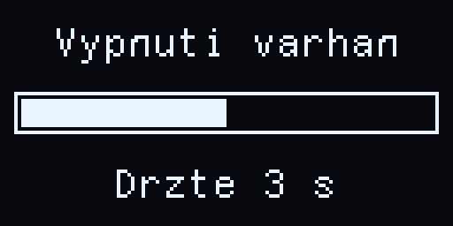
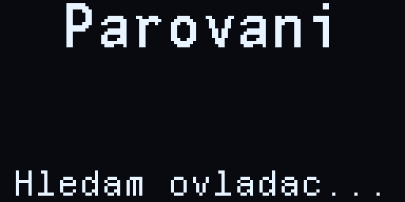

# Nastavení { #nastaveni }

Nastavení otevřete z hlavního menu položkou `Nastaveni`. Položka `Zpet` se vrátí do menu.

## Ovladač

| Položka | Význam |
|---|---|
| `Baterie` | Stav baterie. Nabíjí se USB-C kabelem. |
| `Bluetooth` | Stav spojení se základnou. |
| `Verze FW` | Verze firmwaru. |
| `Sparovat zakl.` | Spárování se základnou. |

## Základna

| Položka | Význam |
|---|---|
| `LED` | Zapnutí a vypnutí kontrolek. Po vypnutí nesvítí žádná zadní kontrolka, ani MIDI A a MIDI B. |
| `Napajeni varhan` | Ruční zapnutí a vypnutí napájení varhan. Po každém restartu je vypnuté. Ruční zapnutí se předá počítači, který začne měřit nečinnost a varhany po nastavené době sám vypne. |
| `Verze FW` | Verze firmwaru. |
| `Displej` | Stav připojeného ukazatele. |
| `Bluetooth` | Stav spojení s ovladačem. |
| `Sparovat ovladac` | Spárování s ovladačem. |
| `Servis` | Podmenu pro správce; je v něm `Ident. MIDI` (identifikace MIDI zařízení základny). Položka `Zpet` se vrátí do Nastavení. |

### Vypnutí varhan za hry nebo nahrávání { #vypnuti-varhan }

Zapnout varhany nebo je vypnout, když nic neběží, stačí jedním stiskem. Vypnete-li je v `Nastaveni`, `Napajeni varhan`, zatímco hraje píseň nebo běží nahrávání, základna ukáže `Vypnuti varhan` / `Drzte 3 s`. Držte stisknutý enkodér 3 s; pak se varhany vypnou. Otočením enkodéru nebo dřívějším puštěním vypnutí zrušíte.

## Párování { #parovani }

Základna si pamatuje jeden ovladač; nový nahradí předchozí.

1. Na ovladači: `Nastaveni`, `Sparovat zakl.`, OK. Máte 60 s.
2. Na základně: `Nastaveni`, `Sparovat ovladac`, stiskněte enkodér.
3. Obě zařízení ukážou `Sparovat? Kod nnnnnn` (šest číslic). Zkontrolujte, že je kód na obou stejný. Párování potvrďte volbou `Ano` na **obou** zařízeních do 30 s. Nabídka začíná na `Ne`, takže nechtěné kliknutí nespáruje.
4. Obě zařízení ukážou `Sparovano`. Zavřete obrazovky (OK na ovladači, enkodér na základně).

Odpovíte-li `Ne` na kterémkoli zařízení, nestihnete-li to do 30 s, nebo druhé zařízení neodpovídá, spojení se přeruší a nic se neuloží. Zařízení, které spárování odmítlo, ukáže `Zamitnuto`. Zkuste to znovu od kroku 1.

Už spárované zařízení se po zapnutí připojí samo, bez dotazu. Telefon ani jiné zařízení se základnou nebo ovladačem spárovat nelze; spárovat je může jen dvojice základna a ovladač, a jen když to potvrdíte na obou.

