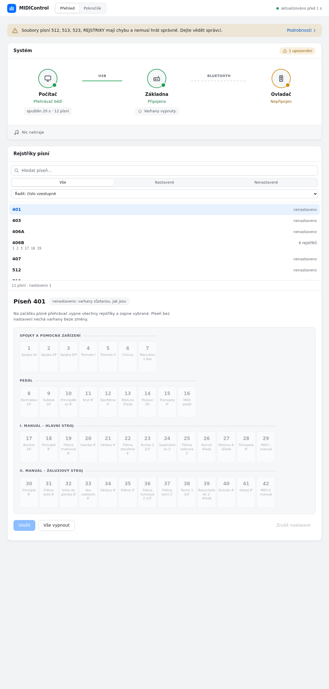

# Nová píseň a rejstříky { #nova-pisen }

Píseň je soubor `<kód>.mid` ve složce písní na počítači (`songs`), například `401.mid` nebo `406A.mid`. Kód má 1 až 4 číslice (nejvýše 1999) a případně písmeno A–D. Nuly na začátku se nepočítají: soubor `0406.mid` je píseň 406 a hraje se i po zadání `406`. Dva soubory se stejným kódem (`406.mid` a `0406.mid`) kontrola písní označí jako chybu názvu.

## Přidání písně

1. Zkopírujte soubor s nahrávkou nebo vlastní MIDI soubor do složky `songs` a přejmenujte ho na kód písně.
2. Píseň je ihned k dispozici na ovladači, počítač restartovat nemusíte.
3. Nastavte rejstříky (níže).

## Rejstříky písně { #rejstriky }

Rejstříky, které se mají zapnout na začátku písně, nastavíte na webové stránce počítače.

1. V prohlížeči otevřete `http://<adresa počítače>:50118/` (záložka **Přehled**).
2. V panelu **Rejstříky písní** napište číslo písně do hledání a stiskněte Enter, nebo píseň vyberte ze seznamu.
3. Klikáním zapněte rejstříky (zapnuté jsou zvýrazněné).
4. Klikněte na **Uložit**.

{ width="90%" }

- **Vše vypnout** vypne všechna tlačítka; po **Uložit** se na začátku písně varhany vypnou a nezapne se nic.
- **Zrušit nastavení** smaže uložený výběr; píseň pak nechá varhany, jak jsou.
- Změna platí od příštího spuštění písně.

Nastavení se ukládá vedle písně do souboru `<kód>.conf`.

!!! warning
    Webová stránka nemá přihlášení. Kdokoli v místní síti může změnit rejstříky nebo nahrát firmware. Používejte ji jen v důvěryhodné síti.
