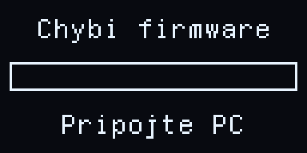

# Opravy a obnova { #opravy }

Nepomohlo-li nic z tabulky, zapište přesný text z displeje a dejte vědět správci.

| Příznak | Co dělat |
|---|---|
| Píseň běží, ale není slyšet | V `Nastaveni` základny zkontrolujte `Napajeni varhan`. Počkejte několik sekund po `Spoustim`. |
| `Cekam na zakladnu` | Zapněte základnu, ovladač vypněte a zapněte. Pomůže-li to, spárujte znovu. |
| `Cekam na PC` | Zkontrolujte, že počítač běží a USB kabel k základně. |
| `Neznama` | Zkontrolujte kód; píseň musí být ve složce `songs`. |
| `PC zaneprazdneno` | Počkejte; probíhá nahrávání nebo aktualizace. |
| `Bez odpovedi` | Stiskněte OK znovu. |
| `Slaba baterie` | Zbývá asi 15 % baterie. Zobrazení po 5 s zmizí (nebo ho zavřete OK či Zpět). Nabijte ovladač přes USB-C. |
| `Chyba mereni` | Baterii se nepodařilo změřit; nezobrazuje se procento. Ovladač vypněte a zapněte, nepomůže-li to, dejte vědět správci. |
| `Zamitnuto` / `Zamitnuto, znovu` | Spárování bylo odmítnuto (`Ne`, vypršelo 30 s nebo druhé zařízení neodpovědělo). Nic se neuložilo; spárujte znovu, viz [Nastavení](nastaveni.md#parovani). |
| `Sparovat? Kod nnnnnn` | Porovnejte kód na obou zařízeních a potvrďte `Ano` na obou. Je-li kód jiný nebo si nejste jisti, zvolte `Ne`. |
| `Nahradit zakl.?` | Ovladač je spárován s jinou základnou. Potvrďte jen při výměně základny. |
| `Stav neznamy` | Ovladač neví, zda se hraje nebo nahrává (po zapnutí nebo ztrátě spojení). Počkejte na PC nebo stiskněte OK. |
| `Nelze: hraje pisen` | Základna odmítla nahrávání, protože hraje píseň. Počkejte na konec písně. |
| `Zaneprazdneno`, `PC nema nahravani`, `Nahravani selhalo` | Nahrávání se nespustilo, viz [Nahrávání](nahravani.md). Potvrďte stiskem enkodéru. |
| `Chybi firmware` / `Pripojte PC` | Základna nemá použitelný firmware. Připojte ji USB kabelem k počítači a nahrajte firmware, viz níže. |
| `Nahravani` | Probíhá nahrávání z základny; ovladač jen zobrazuje stav, nahrávání se z něj nespouští. |
| Displej zhasl | Stiskněte libovolné tlačítko. Nepomůže-li, zapněte ovladač ON/OFF. |
| Po výpadku proudu | Napájení varhan je vypnuté; zapne se samo při další písni. |

## Nové spárování

Postup je v [Nastavení](nastaveni.md#parovani). Použijte ho po výměně ovladače nebo základny. Nepovedlo-li se spárování (`Ne`, vypršení času), nic se neuložilo a stačí postup zopakovat.

## Aktualizace firmwaru

Firmware se nahrává na webové stránce: záložka **Pokročilé**, **Firmware**, soubor `*-update.bin`.

!!! warning
    Během aktualizace zařízení nevypínejte. Základna se restartuje a hra se asi na minutu přeruší.

## Základna po neúspěšné aktualizaci

Zůstane-li základna v zavaděči USB (ABCD:1235), v konzoli počítače spusťte `update base <soubor>`. Případně podržte enkodér při zapnutí základny a nahrajte firmware znovu.

Základna, která nemá firmware (nová, poškozená), zůstane v zavaděči a ukáže `Chybi firmware` / `Pripojte PC`. Čeká bez časového limitu, dokud počítač nenahraje firmware.

Zavaděč umí opravit poškozenou stránku paměti po výpadku proudu při aktualizaci. Po třetí neúspěšné opravě to přestane zkoušet a základna zůstane v režimu aktualizace (`Chybi firmware`), aby se nezacyklila. Nahrajte pak firmware znovu; úspěšná aktualizace počítadlo oprav vynuluje.
