# Ovladač

Ovladač je malý ruční přístroj s displejem a tlačítky. Z lavice s ním vyberete píseň, spustíte ji a zastavíte. Ovladač si s [základnou](zakladna.md) povídá bezdrátově; základna předává příkazy počítači, který píseň hraje.

Texty na displeji ovladače jsou bez diakritiky. V příručce jsou psány přesně tak, jak je displej ukazuje, například `Prehravam`.

## Tlačítka { #tlacka }

Ovladač má 15 tlačítek v pěti řadách po třech, vedle nich tlačítko OK a samostatné tlačítko ON/OFF pro zapnutí a vypnutí.

| Řada | Sloupec 1 | Sloupec 2 | Sloupec 3 |
|---|---|---|---|
| 1 | 1 | 2 | 3 |
| 2 | 4 | 5 | 6 |
| 3 | 7 | 8 | 9 |
| 4 | MF | 0 | nahoru |
| 5 | dolů | doleva | doprava |

Tlačítko OK je samostatné.

!!! note "TODO"
    TODO: Popisky na skříňce ovladače (šipky, MF, OK, ON/OFF) nejsou ve firmwaru. Jak jsou skutečně označeny? Tabulka výše popisuje funkci tlačítek, ne nápisy na nich. Doplnit obrázek ovladače s očíslovanými tlačítky.

Ovladač reaguje, když tlačítko **pustíte**, ne když ho stisknete. Krátký a dlouhý stisk se u tlačítek 0–9, šipek a OK nerozlišuje; podržení tlačítka nic dalšího neudělá. Dlouhé držení má jen ON/OFF (viz [Vypnutí](#vypnuti)).

| Tlačítko | Význam |
|---|---|
| 0–9 | zadat číslici kódu písně |
| nahoru / dolů | při zadávání kódu: písmeno; jinak: otevřít seznam písní; v menu a seznamu: posun |
| doleva | zpět; při zadávání kódu smaže poslední znak |
| doprava | při přehrávání: vybrat tlačítko `Opakovat` |
| OK | potvrdit, spustit píseň, zastavit píseň |
| MF | v přehrávači nemá funkci |

Co tlačítka dělají na jednotlivých obrazovkách, je u každé obrazovky níže.

!!! note "Displej usíná"
    Po 30 s bez stisku se displej vypne, ovladač ale zůstává zapnutý. První stisk displej jen probudí a nic jiného neudělá. Stiskněte tlačítko ještě jednou.

## Zapnutí { #zapnuti }

1. Stiskněte tlačítko ON/OFF.
   Ovladač se zapne a ukáže úvodní obrazovku s nápisem `MIDIControl` a `CONTROLLER`.
2. Počkejte 3 s, nebo stiskněte OK.
   Zobrazí se `Hlavni menu`.

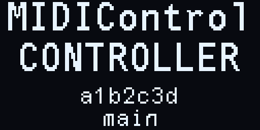

Ovladač se zapne také připojením USB kabelu.

Pod nápisem je číslo verze firmwaru a název větve; slouží technikovi.

## Vypnutí { #vypnuti }

1. Podržte tlačítko ON/OFF.
   Po okamžiku se zobrazí `Vypnuti` a `Drzte 5 s` s ukazatelem postupu.
2. Držte dál, dokud se ukazatel nezaplní (5 s).
   Ovladač se vypne bez další zprávy.

Když tlačítko pustíte dřív, vypnutí se zruší.

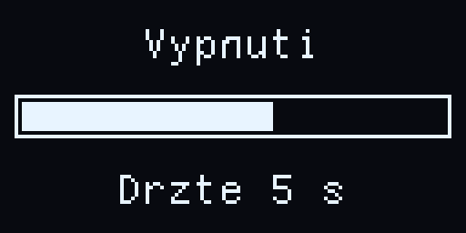

Ovladač se vypne i sám:

- Po 20 minutách bez stisku se zobrazí na 1 s `Vypnuti` a `Necinnost: vypnuti`. Časovač se nespouští, dokud je ovladač připojen přes USB. Neběží ani tehdy, když hraje píseň a počítač je dostupný.
- Při vybité baterii se zobrazí `Vypnuti` a `Slaba baterie` (viz [Baterie](#baterie)).

Po vypnutí zapněte ovladač znovu tlačítkem ON/OFF.

## Baterie a nabíjení { #baterie }

V pravém horním rohu je ikona baterie s pěti stupni. Je vidět v hlavním menu, v nastavení, v přehrávači a v seznamu písní. Vedle ní je ikona spojení (viz [Ztráta spojení](#ztrata-spojeni)).

### Zjištění stavu baterie

1. V `Hlavni menu` vyberte `Nastaveni` a stiskněte OK.
   Otevře se `Nastaveni`.
2. Vyberte `Baterie` a stiskněte OK.
   Zobrazí se stav baterie.

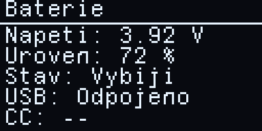

| Řádek | Význam |
|---|---|
| `Napeti: 3.92 V` | napětí baterie; `Napeti: --`, když není změřeno |
| `Uroven: 72 %` | zbývající kapacita |
| `Stav:` | `Nabiji` (nabíjí se), `Nabito` (nabito), `Nenabiji` (USB je připojeno, ale nenabíjí), `Vybiji` (běží z baterie) |
| `USB:` | `Pripojeno` nebo `Odpojeno` |
| `CC:` | proud nabíječky: `3.0 A`, `1.5 A`, `USB (0.5 A)` nebo `--` |

Obrazovku zavřete tlačítkem OK nebo doleva. Dokud je otevřená, displej neusíná.

### Nabíjení

1. Připojte ovladač USB kabelem k nabíječce.
   Na obrazovce `Baterie` se zobrazí `Stav: Nabiji` a `USB: Pripojeno`. Ikona baterie v rohu se animuje.
2. Počkejte, až se zobrazí `Stav: Nabito`.

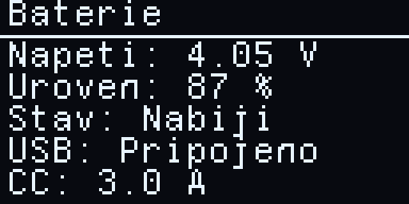

Zobrazená úroveň při provozu z baterie jen klesá, při nabíjení jen roste.

TODO: Jak dlouho trvá nabití a kolik hodin provozu baterie vydrží? Ve firmwaru je jen časový limit nabíjení 12 h; skutečné hodnoty zná jen majitel.

### Slabá baterie

Ovladač před vybitím **nic nezobrazí**. Když napětí pět měření po sobě (po 1 s) klesne pod mezní hodnotu a USB není připojeno, ovladač se vypne a na 1 s ukáže `Vypnuti` a `Slaba baterie`. Před akcí, která nesmí přerušit hru, zkontrolujte ikonu baterie.

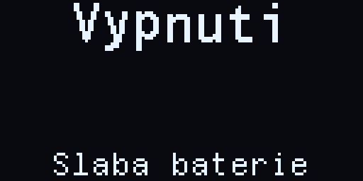

## Hlavní menu { #hlavni-menu }

`Hlavni menu` nabízí dvě položky: `Prehravac` a `Nastaveni`.

1. Tlačítky nahoru a dolů vyberte položku.
   Vybraná položka má plnou tečku.
2. Stiskněte OK.
   Otevře se vybraná obrazovka.

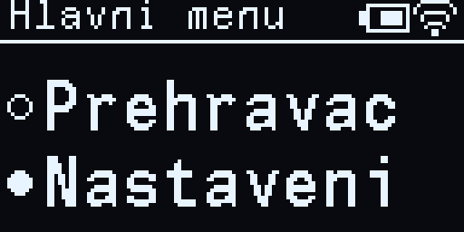

## Zadání čísla písně { #zadani-pisne }

Kód písně má 1 až 4 číslice, hodnotu nejvýše 1999 a nepovinné písmeno A–D (například `406A`). Zadejte ho tak, jak se jmenuje soubor písně.

1. V `Hlavni menu` vyberte `Prehravac` a stiskněte OK.
   Zobrazí se přehrávač s titulkem `Zastaveno` a prázdným polem `- - - -`.
2. Stiskněte číslice kódu, například 4, 0, 6.
   Číslice se doplňují zleva do pole. Dole se objeví tlačítko pro spuštění.
3. Stiskněte tlačítko nahoru (pro písmeno A) nebo víckrát.
   Za číslicemi se objeví písmeno.
4. Stiskněte OK.
   Zobrazí se titulek `Spoustim` a kód písně.

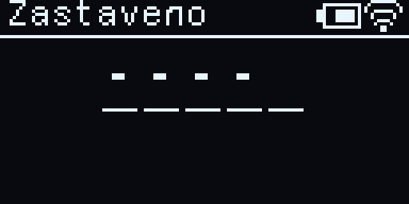

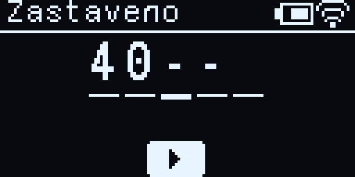

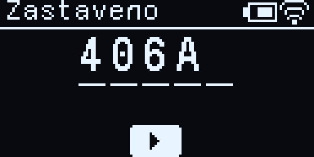

### Písmeno

Tlačítko nahoru střídá písmeno v pořadí žádné, A, B, C, D, žádné. Tlačítko dolů jde opačně. Písmeno lze nastavit, až když je zadána aspoň jedna číslice. Příklad: kód `406B` zadáte číslicemi 4, 0, 6 a dvakrát tlačítkem nahoru.

### Opravy

- Tlačítko doleva smaže nejprve písmeno, potom číslice jednu po druhé.
- Pátá číslice smaže celé zadání a začne nový kód.
- Čtyřciferné číslo nad 1999 ovladač odmítne: na 2,5 s se zobrazí `Nejvyse 1999`.
- Neplatný kód ovladač neodešle; zobrazí `Chybny kod`.

### Co ovladač ukáže po odeslání

| Zpráva | Význam | Co dělat |
|---|---|---|
| `Neznama 999` | počítač píseň s tímto kódem nenašel | zkontrolujte kód nebo otevřete seznam písní |
| `PC nedostupne` | základna nemá spojení s počítačem | viz [Ztráta spojení](#ztrata-spojeni) |
| `PC zaneprazdneno` | počítač nemůže příkaz teď přijmout | zkuste to za chvíli |
| `Bez odpovedi` | nikdo neodpověděl | zkuste to znovu |
| `Nepripojeno` | ovladač nemá spojení se základnou | viz [Ztráta spojení](#ztrata-spojeni) |
| `Zkuste znovu` | příkaz se nepodařilo odeslat | stiskněte OK znovu |
| `Odmitnuto` | počítač příkaz odmítl z jiného důvodu | zkuste to znovu; TODO: jaké důvody? |

Zpráva zmizí po 2,5 s.

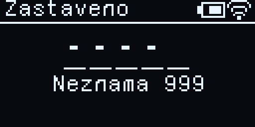

## Přehrání, zastavení, přidání sloky { #prehravani }

### Spuštění písně

1. Zadejte kód písně (viz [Zadání čísla písně](#zadani-pisne)) a stiskněte OK.
   Titulek se změní na `Spoustim`.
2. Počkejte, až počítač píseň spustí.
   Titulek je `Prehravam`, dole je tlačítko `Stop`.

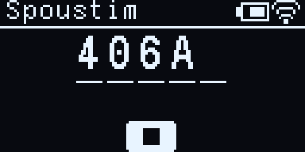

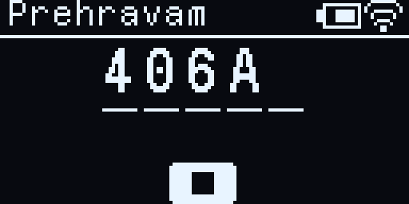

Když už něco hraje a zadáte jiný kód, počítač přepne na novou píseň. Pokud je varhanní zdroj vypnutý, počítač ho sám zapne a chvíli čeká (viz [Základna](zakladna.md)).

Během hry ovladač ukazuje název části písně, kterou počítač hraje: `Sloka: 2`. Dlouhý název se posouvá.

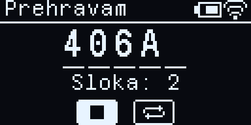

### Zastavení písně

1. Stiskněte OK, když není zadána žádná číslice a je vybráno `Stop`.
   Titulek je `Zastavuji`.
2. Počkejte na potvrzení.
   Titulek je `Zastaveno` a pole kódu je prázdné.

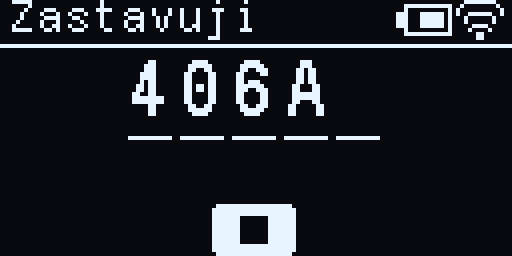

Když při hře není vybráno `Stop` (například po výběru `Opakovat`), stiskněte tlačítko doleva. Tím vyberete `Stop`. Pak stiskněte OK.

Stisk OK při nic nehrajícím přehrávači bez zadaného kódu nedělá nic. Zpráva `Nehraje se` znamená, že počítač žádnou píseň nehraje; ovladač se vrátí do stavu `Zastaveno`.

### Přidání sloky { #pridani-sloky }

Přidání sloky přehraje právě hranou sloku ještě jednou, až skončí. Stisky se sčítají.

1. Počkejte, až se při hře objeví název sloky, například `Sloka: 2`.
   Vedle `Stop` se objeví druhé tlačítko `Opakovat`.
2. Stiskněte tlačítko doprava.
   Vybráno je `Opakovat`.
3. Stiskněte OK.
   Název sloky se doplní: `Sloka: 2 (x1)`. Číslo v závorce je počet opakování, která zbývají.
4. Chcete-li přidat další, stiskněte OK znovu.
   Zobrazí se `Sloka: 2 (x2)`.

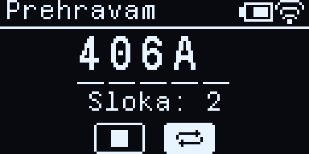

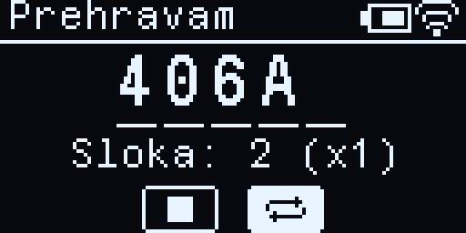

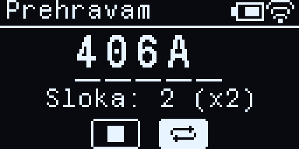

TODO: Co přesně se po přidání ukáže u písně bez označených slok (tlačítko `Opakovat` se objeví jen po zprávě o části písně z počítače)? Je to záměr, že u takových písní přidání sloky nejde?

### Pozastavení a pokračování

Ovladač **nemá** tlačítko pozastavit ani pokračovat. Existuje jen `Stop`, který píseň ukončí; nové spuštění začíná od začátku písně.

TODO: Specifikace (SYS-USE-09, SYS-USE-21) počítá s pozastavením a pokračováním. Bude to doplněno, nebo se z příručky úplně vynechá?

## Seznam písní { #seznam-pisni }

### Výběr písně ze seznamu

1. V přehrávači bez zadaných číslic stiskněte tlačítko nahoru nebo dolů.
   Zobrazí se `Pisne` s textem `Nacitani...` a `Cekam na PC`.
2. Počkejte nejvýše 3 s.
   Zobrazí se seznam kódů písní.
3. Tlačítky nahoru a dolů vyberte píseň.
   Vybraná má plnou tečku. Na konci stránky se po stisku dolů načte další stránka; na jejím začátku vás stisk nahoru vrátí na předchozí.
4. Stiskněte OK.
   Píseň se spustí jako při zadání kódu.

Poslední řádek seznamu je `Zpet`. Seznam opustíte také tlačítkem doleva.

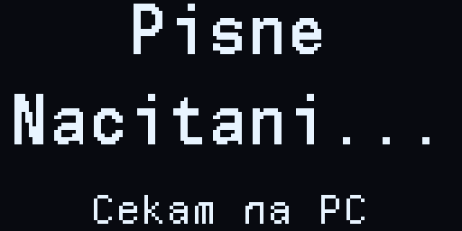

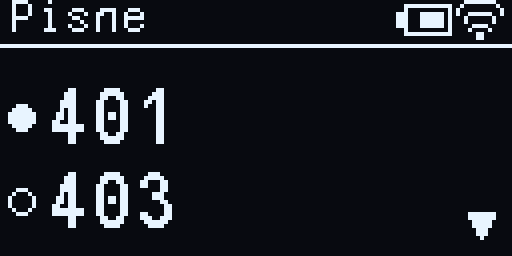

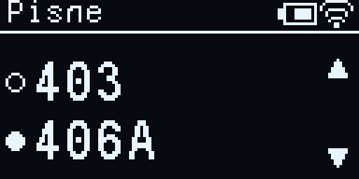

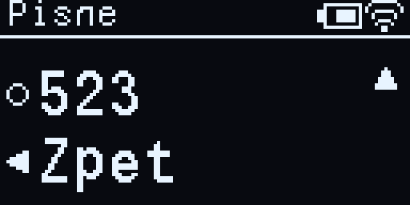

### Když seznam nejde načíst

Zobrazí se jedna z chyb: `Bez odpovedi`, `PC nedostupne`, `Odmitnuto`, `Nepripojeno`, `Zaneprazdneno` (ovladač nemohl příkaz odeslat). Stisk OK nebo doleva seznam zavře. Znovu ho otevřete tlačítkem nahoru nebo dolů v přehrávači.

Prázdný seznam ukáže `Zadne pisne`; v tom případě počítač nenašel žádné písně s platným kódem.

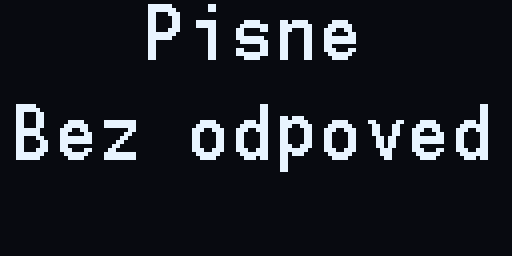

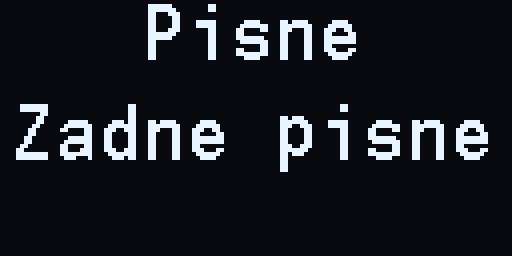

## Nastavení { #nastaveni }

`Nastaveni` nabízí `Baterie`, `Bluetooth`, `Verze FW`, `Sparovat zakl.` a `Zpet`. Volíte tlačítky nahoru a dolů a OK; `Zpet` nebo tlačítko doleva vrátí do hlavního menu.

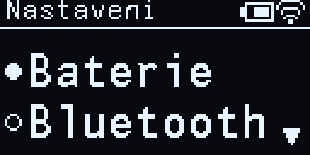

- `Baterie`: viz [Baterie a nabíjení](#baterie).
- `Verze FW`: ukáže `Revize`, `Vetev`, `Datum` a `Cas` sestavení firmwaru. Hodí se při hlášení závady.
- `Bluetooth`: ukáže stav bezdrátového spojení.
- `Sparovat zakl.`: viz [Párování](#parovani).

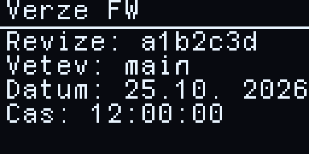

### Stav Bluetooth

| Řádek | Význam |
|---|---|
| `Modul: OK` | bezdrátový modul pracuje. Další možnosti: `OK, bez RST`, `neodpovida`, `mlci`, `?` |
| `Spojeni: Ano` | ovladač je spojen se základnou (`Ne`: není) |
| `Sparovano: Ano` | ovladač je spárován se základnou |
| `Zakladna: Ano` | základna odpovídá |
| `MAC:` | adresa spárovaného přístroje, nebo `--` |

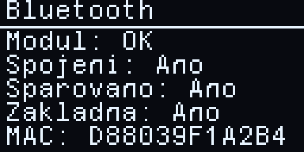

TODO: Co má organista dělat při `Modul: neodpovida`, `Modul: mlci` a `Modul: OK, bez RST`? Zatím: kontaktujte správce (viz [Řešení problémů](problemy.md)).

## Párování s novou základnou { #parovani }

Ovladač je spárován vždy s jednou základnou. Párování nahradí dosavadní spárování. Při otevření okna párování se ovladač od původní základny odpojí.

Párovat musíte na obou přístrojích, ovladači a základně.

1. Na ovladači otevřete `Nastaveni`, vyberte `Sparovat zakl.` a stiskněte OK.
   Zobrazí se `Parovani`, `Cekam na zakladnu` a `Zbyva 60 s`; čas odpočítává po sekundách.
2. Na základně spusťte párování podle kapitoly [Základna](zakladna.md), položka `Sparovat ovladac`.
   Po úspěchu se na ovladači zobrazí `Sparovano` a adresa základny.
3. Stiskněte OK.
   Ovladač se vrátí do nastavení.

Okno párování trvá 60 s. Když za tu dobu žádná základna nepřijde, zobrazí se `Cas vyprsel` a `Nesparovano`. Zkuste párování zopakovat. Tlačítko OK nebo doleva okno zavře.

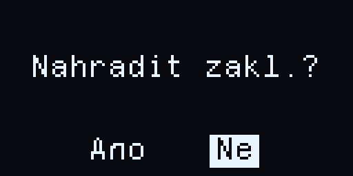

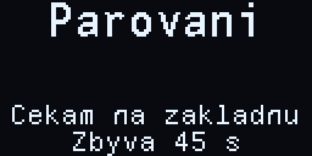

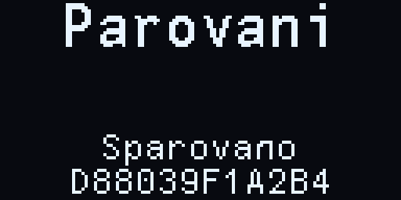

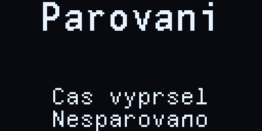

Ovladač při párování nic nepotvrzuje: párování řídí základna. Dotaz `Sparovat?` se při běžném párování nezobrazí. Kdyby se přesto objevil (jen s šestimístným kódem), je pouze informativní: odpověď nic nemění a základnu neodpojí.

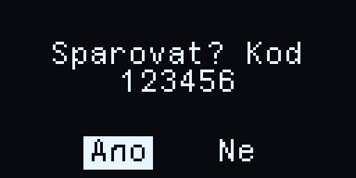

TODO: Kdy a proč se páruje? (Při první instalaci a po výměně základny; ověřit u majitele.)

## Ztráta spojení se základnou nebo s počítačem { #ztrata-spojeni }

V pravém horním rohu je ikona bezdrátového spojení:

| Ikona | Význam |
|---|---|
| žádná | ovladač není spojen se základnou |
| slabá (jedna čárka) | spojení je, ale základna se neozývá |
| plná | základna odpovídá |

Základna se ozývá každé 2 s; ovladač ji považuje za ztracenou po 6 s ticha.

Když základna nebo počítač chybí, přes hlavní menu se zobrazí `Odpojeno`:

- `Cekam na zakladnu`: ovladač nemá spojení se základnou.
- `Cekam na PC`: základna je dostupná, počítač ne.

Pod tím je nápis `Stisk: Nastaveni`.

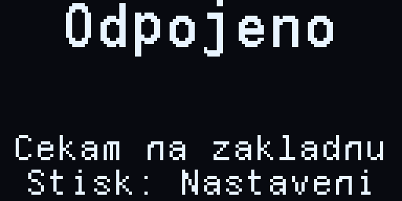

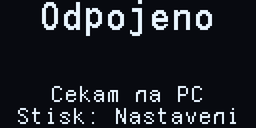

Na této obrazovce funguje jen OK: otevře `Nastaveni` (například pro kontrolu `Bluetooth` nebo pro [párování](#parovani)). Odtud se tlačítkem `Zpet` vrátíte zpět na `Odpojeno`. Ostatní tlačítka se ignorují. Obrazovka zmizí sama, jakmile se spojení obnoví, a ovladač ukáže `Hlavni menu`.

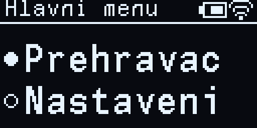

Pokud počítač zmizí při přehrávání, přehrávač se vrátí do stavu `Zastaveno`.

Co dělat, když se spojení neobnoví: viz [Řešení problémů](problemy.md).

## Aktualizace firmwaru ovladače { #aktualizace }

Aktualizaci spouští správce z webové stránky. Během ní ovladač ukazuje `Aktualizace` s ukazatelem a textem `Prijem dat` (přijímá data), `Instalace` (instaluje) nebo `Chyba aktualizace` (selhala). Všechna tlačítka jsou po tu dobu bez funkce. Ovladač nevypínejte.

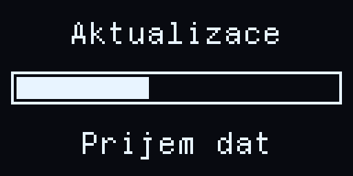

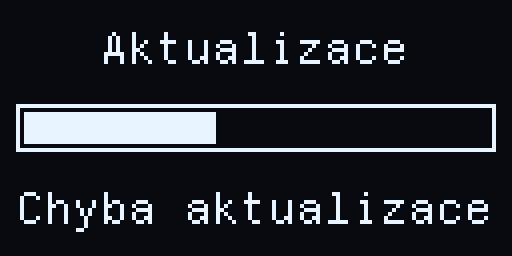

TODO: Jak dlouho smí aktualizace trvat, než se zasahuje? Orientačně 75 s až zhruba 2,5 min podle spojení; ověřit na lavici.
