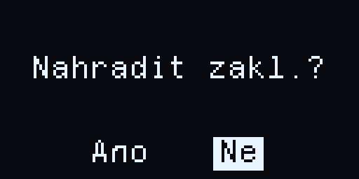
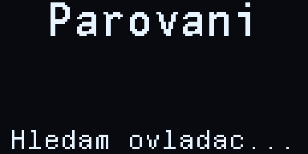
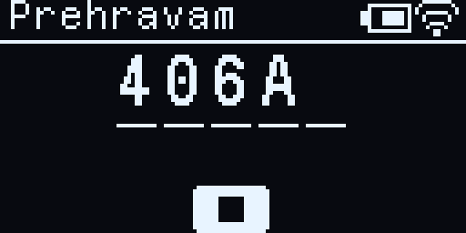
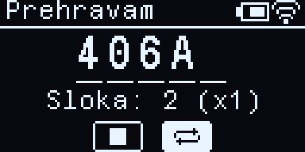
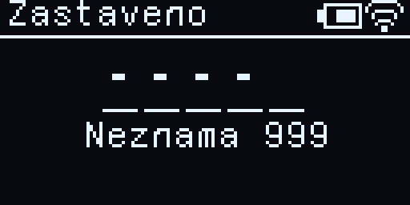
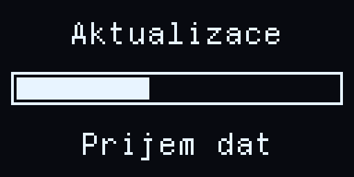
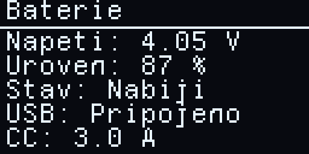

# Typické postupy

Kapitola vede krok za krokem situacemi, které se při provozu opakují. Za každým krokem je uvedeno, co se má objevit na displeji. Texty displejů jsou psány bez diakritiky, jak je přístroj zobrazuje. Pokud se obrazovka liší, jděte do kapitoly [Řešení problémů](problemy.md).

!!! note
    Postupy jsou sestaveny z kódu firmwaru a programu. Dne 16. 11. 2026 byly ověřeny na simulátoru displejů ovladače a základny: první zprovoznění, běžná bohoslužba, přidání sloky, píseň nenalezena, nabíjení a po výpadku proudu. U nahrávání, rejstříků a aktualizace firmwaru byly ověřeny texty stránky a programu, celý postup na přístroji zatím ne. Na přístroji zatím neověřil žádný postup nikdo.

Přehled postupů:

| Postup | Odkaz |
|---|---|
| První zprovoznění a párování | [postup-prvni-instalace](#postup-prvni-instalace) |
| Běžná bohoslužba | [postup-bezna-sluzba](#postup-bezna-sluzba) |
| Přidání sloky | [postup-pridat-sloku](#postup-pridat-sloku) |
| Pozastavení a pokračování | [postup-pauza](#postup-pauza) |
| Píseň nenalezena | [postup-pisen-nenalezena](#postup-pisen-nenalezena) |
| Nahrání nové písně a její přehrání | [postup-nahravani](#postup-nahravani) |
| Nastavení rejstříků písně | [postup-rejstriky](#postup-rejstriky) |
| Aktualizace firmwaru | [postup-aktualizace-firmwaru](#postup-aktualizace-firmwaru) |
| Nabíjení ovladače | [postup-nabijeni](#postup-nabijeni) |
| Po výpadku proudu | [postup-po-vypadku-proudu](#postup-po-vypadku-proudu) |

## První zprovoznění a párování { #postup-prvni-instalace }

Instalaci programu v počítači a zapojení základny provádí správce (viz [Pro správce](sprava.md)). Tento postup předpokládá, že základna je zapojena, počítač běží a ovladač je nabitý.

1. Zapněte základnu (napájení základny) a počkejte na úvodní obrazovku.
   Po 3 s se ukáže hlavní menu. Základna bez spárovaného ovladače má nadpis `Sparuj ovladac`. Dokud není počítač připojen, překrývá menu obrazovka `Odpojeno`.
2. Zapněte ovladač tlačítkem ON/OFF.
   Ukáže se `MIDIControl` a `CONTROLLER`, po 3 s (nebo po stisku OK) `Hlavni menu`.
3. Na ovladači otevřete `Nastaveni`, vyberte `Sparovat zakl.` a stiskněte OK. **Dělejte to jako první.**
   Ovladač ukáže `Parovani`, `Cekam na zakladnu` a odpočet `Zbyva 60 s`.
4. Do 60 s na základně otevřete `Nastaveni`, vyberte `Sparovat ovladac` a stiskněte ovladač (enkodér).
   Základna ukáže `Parovani` a `Hledam ovladac...`. Hledání trvá nejvýše 15 s.
5. Počkejte na výsledek.
   Základna ukáže `Sparovano`, ovladač ukáže `Sparovano` a adresu základny.
6. Stiskněte OK na ovladači a stiskněte enkodér na základně.
   Obrazovky se zavřou. V rohu ovladače je plná ikona bezdrátového spojení a na základně svítí LED `Bluetooth`.
7. Otevřete na ovladači `Prehravac` a zkušebně spusťte píseň (viz [postup-bezna-sluzba](#postup-bezna-sluzba)).
   Ovladač ukáže `Prehravam`, zazní varhany a tabule ukáže číslo písně.

Selhání párování: `Cas vyprsel` a `Nesparovano` na ovladači (okno 60 s vypršelo), `Ovladac nenalezen` nebo `Parovani selhalo` na základně. Postup zopakujte od kroku 3. Význam hlášek je v kapitole [Řešení problémů](problemy.md). Základna si pamatuje jediný ovladač; nové párování předchozí nahradí.

Podrobnosti: [Párování s novou základnou](ovladac.md#parovani), [Párování ovladače](zakladna.md#parovani-zakladna).

TODO: Doplnit, kdy se páruje znovu (výměna ovladače nebo základny).

## Běžná bohoslužba { #postup-bezna-sluzba }

Před začátkem musí být zapnutá základna a počítač s programem. Varhany nemusíte zapínat: napájení varhan spíná základna sama.

1. Zapněte ovladač tlačítkem ON/OFF.
   Ukáže se úvodní obrazovka a po 3 s `Hlavni menu`.
2. Zkontrolujte ikonu bezdrátového spojení v pravém horním rohu a ikonu baterie.
   Spojení je plná ikona. Když je přes menu `Odpojeno`, počkejte, až zmizí (viz [Řešení problémů](problemy.md)).
3. Vyberte `Prehravac` a stiskněte OK.
   Ukáže se `Zastaveno` a prázdné pole kódu.
4. Zadejte číslo písně číslicemi, případně písmeno tlačítkem nahoru.
   Číslice se objevují v poli kódu. Například pro `406B` stiskněte 4, 0, 6 a dvakrát nahoru.
5. Stiskněte OK.
   Ukáže se `Spoustim`. Je-li napájení varhan vypnuté, počítač ho zapne a asi 3 s čeká na zahřátí.
6. Počkejte na začátek hry.
   Ukáže se `Prehravam`, kód písně a název části, například `Sloka: 1`. Tabule ukáže číslo písně.
7. Další píseň spustíte zadáním jejího kódu a OK. Počítač přepne na novou píseň.
8. Hru zastavíte: bez zadaných číslic stiskněte OK, je-li vybráno `Stop` (jinak nejdřív tlačítko doleva).
   Ukáže se `Zastavuji` a pak `Zastaveno`.
9. Po bohoslužbě vypněte ovladač podržením ON/OFF asi 5 s.
   Ukáže se `Vypnuti` a `Drzte 5 s` s ukazatelem. Po zaplnění se ovladač vypne.

Po doznění písně počítač sám vypne napájení varhan (pokud správce nenastavil jinak). Ovladač se bez stisku sám vypne po 20 minutách; neběží to, dokud je připojen kabel USB.

Podrobnosti: [Zadání čísla písně](ovladac.md#zadani-pisne), [Přehrání, zastavení, přidání sloky](ovladac.md#prehravani).

## Přidání sloky { #postup-pridat-sloku }

Přidání sloky přehraje právě hranou sloku ještě jednou, až skončí. Lze přidat víckrát.

1. Počkejte, až při hře ovladač ukáže název sloky, například `Sloka: 2`.
   Vedle `Stop` se objeví tlačítko `Opakovat`.
2. Stiskněte tlačítko doprava.
   Je vybráno `Opakovat`.
3. Stiskněte OK.
   Název se změní na `Sloka: 2 (x1)`. Číslo je počet přidaných opakování.
4. Chcete-li přidat další, stiskněte OK znovu.
   Ukáže se `Sloka: 2 (x2)`.
5. Hru dále zastavíte tlačítkem doleva (vybere `Stop`) a OK.
   Ukáže se `Zastavuji` a pak `Zastaveno`.

Když nic nehraje, přidání sloky se odmítne. Přidat sloku z displeje základny nelze; základna při hře umí jen zastavit.

## Pozastavení a pokračování { #postup-pauza }

Systém **nemá** pozastavení ani pokračování. Ovladač nabízí jen `Stop` a počítač zastavení bere jako ukončení písně.

Co lze udělat:

1. Zastavte píseň (OK při vybraném `Stop`).
   Ukáže se `Zastavuji` a pak `Zastaveno`.
2. Až budete chtít hrát znovu, zadejte kód písně a stiskněte OK.
   Píseň začne od začátku.

Chcete-li část písně zopakovat, použijte před koncem sloky [přidání sloky](#postup-pridat-sloku).

TODO: Specifikace (SYS-USE-09, SYS-USE-21) počítá s pozastavením a pokračováním. Bude doplněno, nebo se z příručky vynechá?

## Píseň nenalezena { #postup-pisen-nenalezena }

1. Zadejte kód a stiskněte OK.
   Když počítač píseň nezná, ukáže se na 2,5 s `Neznama` a kód, například `Neznama 999`.
2. Zkontrolujte kód: `12` a `012` jsou různé písně a písmeno A až D se píše za čísla.
3. Podívejte se do seznamu: bez zadaných číslic stiskněte nahoru nebo dolů.
   Ukáže se `Pisne`, krátce `Nacitani...` a seznam kódů.
4. Tlačítky nahoru a dolů vyberte píseň a stiskněte OK.
   Píseň se spustí jako při zadání kódu.
5. Pokud v seznamu píseň není, soubor v počítači chybí. Dejte vědět správci.
   Pokud je seznam prázdný, ukáže se `Zadne pisne`.

Na webové stránce se u souborů s chybou ukáže upozornění `Soubor písně ... má chybu a nemusí hrát správně.` (viz [Řešení problémů](problemy.md)).

Podrobnosti: [Seznam písní](ovladac.md#seznam-pisni).

## Nahrání nové písně a její přehrání { #postup-nahravani }

Nahrávat zatím **nelze z ovladače ani ze základny**. Položka `Nahraj` v menu základny nic nedělá. Nahrávání dnes spouští správce v konzoli počítače.

1. Správce na počítači zadá příkaz `record`.
   Program zapne varhany (je-li třeba), počká na zahřátí a začne zaznamenávat hru. Do protokolu se zapíše `Recording to <soubor>`.
2. Varhaník zahraje píseň na varhany.
3. Správce zadá příkaz `stop`.
   Záznam se uloží do složky pro nahrávky pod jménem ve tvaru `RRRR-MM-DDTHH:MM:SS.mid`.
4. Aby šlo píseň přehrát z ovladače, musí soubor ve složce písní nést platný kód písně (například `408.mid`).
   Nahrávka v této složce není a nepřejmenuje se sama.

TODO: Jak se nahrávka má dostat mezi hratelné písně (kopie a přejmenování správcem)? Kód to nedělá a nikde to není popsáno. Zeptat se majitele.

TODO: Bude se nahrávání spouštět ze základny (SYSTEM.md SYS-REC-01)? Dnes ne.

Podrobnosti pro správce: [Pro správce](sprava.md). Stav na základně: [Nahrávání](zakladna.md#nahravani).

## Nastavení rejstříků písně { #postup-rejstriky }

Rejstříky se nastavují na webové stránce. Při startu písně počítač vypne všechny rejstříky a zapne vybrané. Píseň bez nastavení nechá varhany, jak jsou.

1. Otevřete webovou stránku počítače (adresa `http://<počítač>:50118/`) a najděte panel `Rejstříky písní`.
   Vidíte seznam písní a pole `Hledat píseň…`.
2. Napište číslo písně nebo klepněte na její řádek.
   Pod seznamem se ukáže nadpis `Píseň <kód>` a tlačítka rejstříků po skupinách.
3. Klepáním zapínejte a vypínejte rejstříky.
   Počítadlo ukazuje `N z M zapnuto` a značka `neuložené změny`.
4. Klepněte na `Uložit`.
   Tlačítko na 1,2 s ukáže `Uloženo` a značka je `uloženo`.
5. Hotovo. Rejstříky se použijí při příštím spuštění písně. Právě hraná píseň se nemění.

Volby: `Vše vypnout` uloží prázdný výběr (při startu písně se varhany vypnou). `Zrušit nastavení` výběr smaže a při startu písně se varhany nezmění.

Podrobnosti: [Nastavení rejstříků písně](web.md#rejstriky).

## Aktualizace firmwaru { #postup-aktualizace-firmwaru }

Aktualizaci dělá správce z webové stránky, stránka `Pokročilé`, část `Firmware`. Aktualizovat lze základnu i ovladač.

1. Zastavte přehrávanou píseň. Při hře stránka aktualizaci odmítne.
2. Ověřte, že základna je připojena kabelem USB. Pro aktualizaci ovladače musí být ovladač spojen se základnou.
3. Na stránce `Pokročilé`, `Firmware` přetáhněte na příslušnou kartu soubor `-update.bin` z adresáře `build/` firmwaru.
   Stránka soubor zkontroluje a ukáže `Check: trailer, board ID and CRC OK`.
4. Klepněte na `Flash base` nebo `Flash controller` a potvrďte dotaz.
   Ukáže se ukazatel postupu `Flashing N %`.
5. Při aktualizaci ovladače ovladač ukazuje `Aktualizace` a `Prijem dat`, pak `Instalace`. Nevypínejte ho a tlačítka nepoužívejte.
   Základna při tom ukazuje `Aktualizace` a `Prenos do ovladace`, pak `Instalace ovladace`.
6. Při aktualizaci základny se základna restartuje. Přehrávání i spojení s ovladačem na asi minutu přestanou.
   Základna může ukázat `Aktualizace` a `Nevypinejte`.
7. Počkejte na `Last update finished`.
   Při `Last update FAILED` nebo hlášce `Chyba aktualizace` (nebo `Chyba, opakujte` na základně) postup zopakujte. Postup při neúspěchu je v kapitolách [Základna](zakladna.md#aktualizace) a [Aktualizace firmwaru](web.md#aktualizace-firmwaru).

!!! warning
    Zařízení během aktualizace nevypínejte a neodpojujte kabel USB. Přerušená aktualizace základny nechá základnu v zaváděcím režimu, kde čeká na opakování.

TODO: Jak dlouho smí aktualizace trvat, než se zasahuje? Orientačně do několika minut; ověřit na přístroji.

## Nabíjení ovladače { #postup-nabijeni }

1. Zkontrolujte stav: `Nastaveni`, `Baterie`, OK.
   Řádek `Uroven:` ukazuje procenta, `Stav:` ukazuje `Vybiji` při provozu z baterie.
2. Připojte ovladač kabelem USB-C k nabíječce.
   Ikona baterie v rohu se animuje. Na stránce `Baterie` je `USB: Pripojeno` a `Stav: Nabiji`.
3. Počkejte, až se ukáže `Stav: Nabito`.
4. Odpojte kabel. Ovladač pak běží z baterie (`Stav: Vybiji`).

Konektor USB-C ovladače slouží jen k nabíjení, ne k přenosu dat ani MIDI. Dokud je kabel připojen, ovladač se sám nevypne po 20 minutách. Ovladač se při připojení kabelu zapne sám.

Když baterie klesne příliš, ovladač před vypnutím na 1 s ukáže `Vypnuti` a `Slaba baterie`. Na webové stránce se objeví upozornění `Baterie ovladače je slabá. Nabijte ho.` (do 15 % bez nabíjení) nebo `Baterie ovladače je vybitá. Nabijte ho.`.

TODO: Jak dlouho trvá nabití a jak dlouho baterie vydrží? Jaká nabíječka? Zná jen majitel.

## Po výpadku proudu { #postup-po-vypadku-proudu }

1. Počkejte, až se zapne počítač a program `midicontrol`.
   TODO: Spouští se program po zapnutí počítače sám (systemd, linger)? Ověřit u správce a doplnit.
2. Základna se po obnově napájení spustí sama. Ukáže úvodní obrazovku a za 3 s hlavní menu. Nastavení a spárovaný ovladač zůstanou. Nemusíte párovat.
   Dokud počítač neběží, je přes menu `Odpojeno`.
3. **Napájení varhan je po výpadku vždy vypnuto.** Zapne ho počítač při přehrání další písně, nebo ručně v `Nastaveni`, `Napajeni varhan`.
4. Ovladač je napájen baterií a výpadek ho obvykle nezasáhl. Když se vypnul, zapněte ho tlačítkem ON/OFF.
   Ovladač se k základně připojí sám, obvykle do několika sekund. Ikona spojení musí být plná.
5. Píseň hranou při výpadku nic neobnoví. Zadejte kód znovu a stiskněte OK.

Podrobnosti: [Po výpadku proudu](zakladna.md#po-vypadku).
