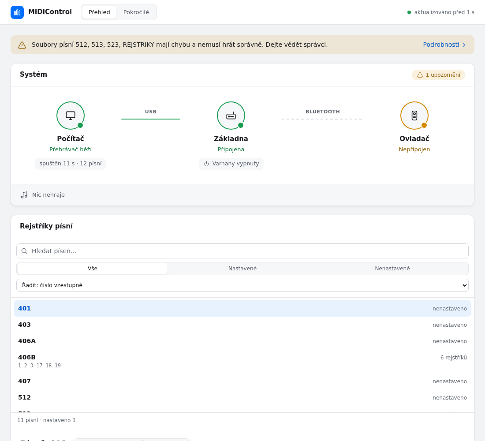
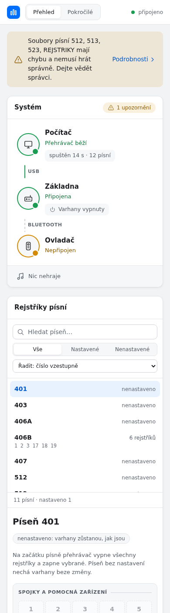
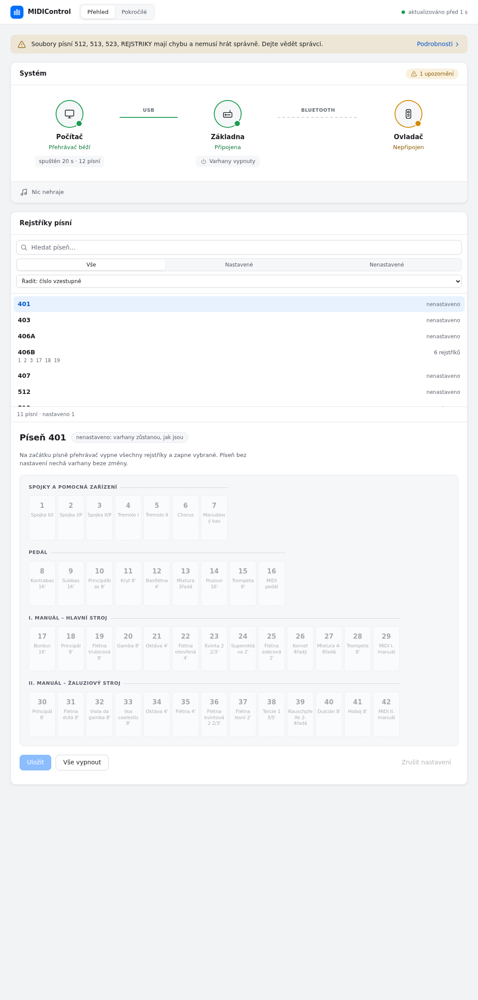
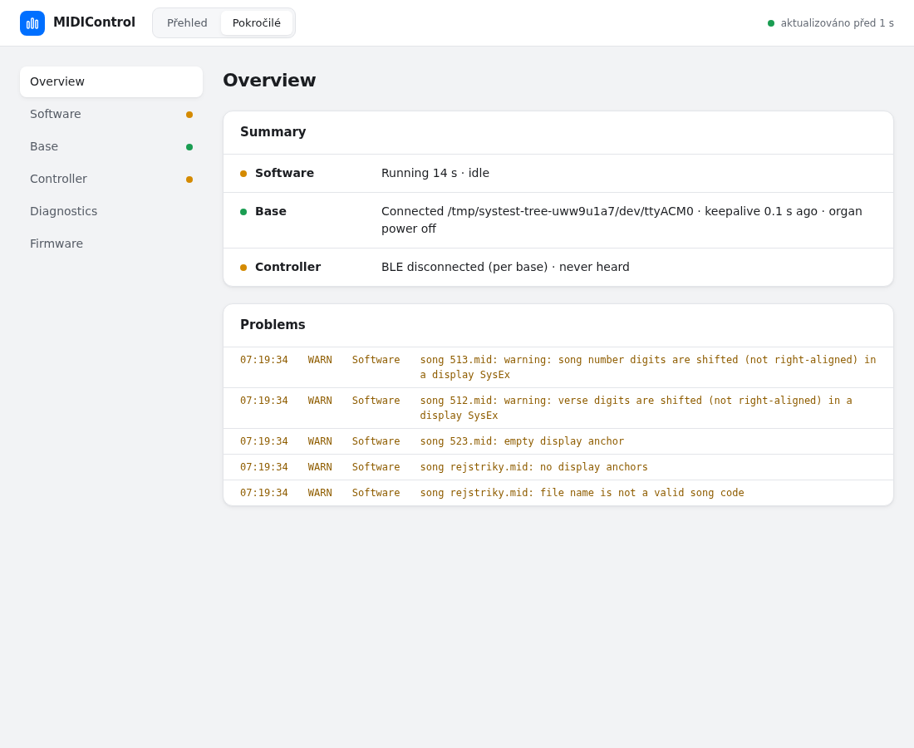
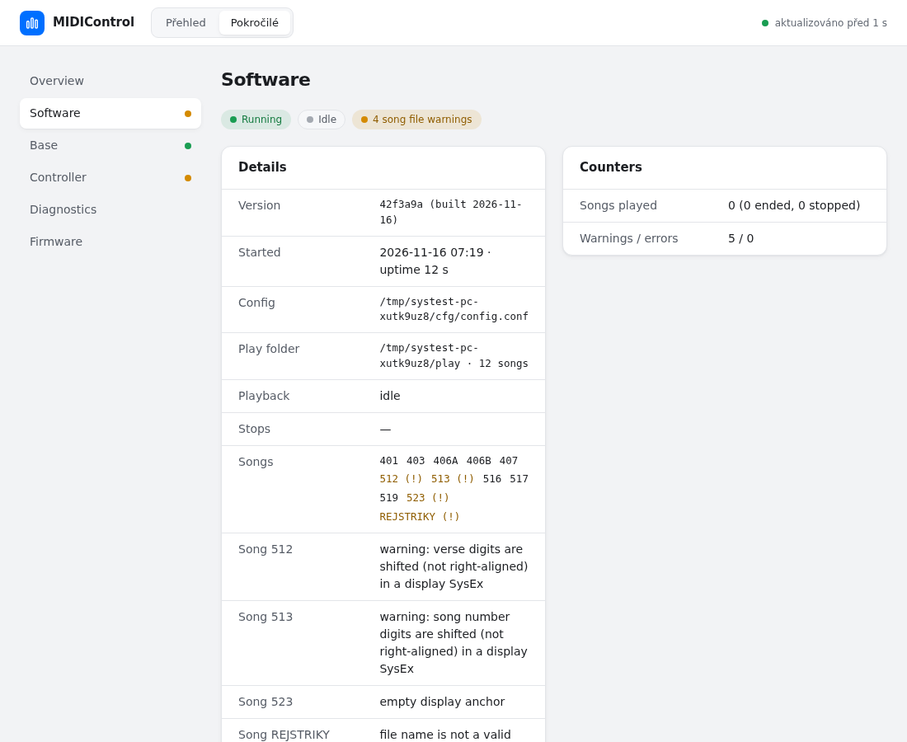
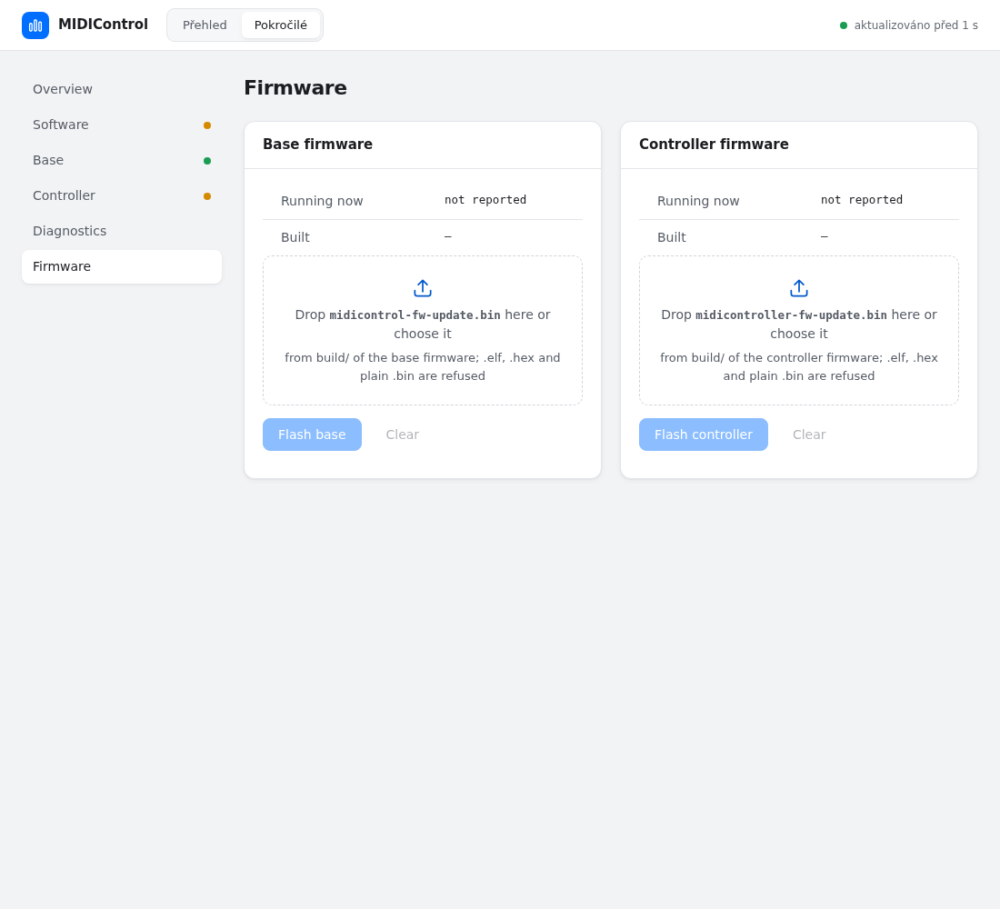

# Webová stránka { #web }

Počítač s programem MIDIcontrol zobrazuje stavovou stránku. Ukáže, jestli jsou
všechny části systému v pořádku, co právě hraje a jaké rejstříky se zapnou na
začátku které písně. Stránku otevřete v prohlížeči na telefonu, tabletu nebo
počítači ve stejné síti. Přihlašovat se nemusíte.

!!! warning
    Stránka nemá žádné přihlášení ani šifrování. Kdokoli, kdo se z místní sítě
    dostane na její adresu, může změnit rejstříky písní a nahrát nový firmware do
    základny nebo ovladače. Používejte ji jen v důvěryhodné síti.

## Otevření stránky { #otevreni }

1. Zjistěte adresu počítače, na kterém běží MIDIcontrol (například `192.168.1.20`
   nebo jeho jméno v síti).
2. V prohlížeči otevřete `http://<adresa počítače>:50118/`.
   Výchozí port je 50118. Správce ho může změnit v konfiguračním souboru
   (viz [Konfigurace](sprava.md#konfigurace)).
3. Stránka se načte a v pravém horním rohu se objeví text
   „aktualizováno před N s“. Údaje se obnovují každou sekundu.

Nahoře jsou dvě záložky: **Přehled** (pro varhaníka) a **Pokročilé** (pro správce,
viz [Pokročilé](#pokrocile)). Stránka je přizpůsobená i úzké obrazovce telefonu.

Text v pravém horním rohu:

| Text | Význam |
|---|---|
| „připojování…“ | Stránka ještě nedostala první údaje. |
| „aktualizováno před N s“ | Údaje jsou čerstvé. |
| „bez spojení s přehrávačem“ | Přehrávač neodpověděl do 3 s. Zobrazené údaje nemusí platit. |

!!! note
    TODO: Má správce doporučit pevnou IP adresu nebo síťové jméno počítače, aby se
    adresa stránky neměnila? Otázka pro majitele.

## Přehled { #prehled }

{ width="90%" }

Přehled obsahuje shora dolů: upozornění, panel **Systém** a panel
**Rejstříky písní**. Než dorazí první údaje, panel Systém ukazuje
„Načítám stav systému…“.

### Upozornění { #upozorneni }

Upozornění je pruh nad panelem Systém. Žlutý pruh říká, že něco vyžaduje
pozornost. Červený pruh je naléhavý. U většiny upozornění je odkaz
**Podrobnosti**, který otevře příslušnou stránku v Pokročilém zobrazení.

| Upozornění | Kdy se zobrazí | Barva | Co dělat |
|---|---|---|---|
| Přehrávač neodpovídá, údaje na stránce nemusí být aktuální. | Stránka nedostává odpověď od přehrávače. | červená | Řekněte správci. Zkontrolujte, že počítač běží. |
| Probíhá aktualizace firmwaru základny. | Probíhá aktualizace základny. | žlutá | Počkejte. Nezapínejte píseň. |
| Základna není připojena. Zkontrolujte USB kabel mezi počítačem a základnou. | Počítač nevidí základnu. | žlutá | Zkontrolujte USB kabel mezi počítačem a základnou. |
| Základna neodpovídá. | Základna je připojená, ale neodpovídá. | červená | Řekněte správci. |
| Základna se po poruše firmwaru sama restartovala. Pokud vše hraje, stačí to říct správci. | Základna nahlásila poruchu, kterou ještě nikdo neoznačil jako viděnou. | žlutá | Pokud vše hraje, informujte správce. |
| Ovladač se po poruše firmwaru sám restartoval. Pokud vše hraje, stačí to říct správci. | Totéž pro ovladač. | žlutá | Pokud vše hraje, informujte správce. |
| Baterie ovladače je vybitá. Nabijte ho. | Baterie ovladače je kriticky nízká. | červená | Nabijte ovladač. |
| Baterie ovladače je slabá. Nabijte ho. | Baterie ovladače má nejvýše 15 % a nenabíjí se. | žlutá | Nabijte ovladač. |
| Soubory písní 512, 513, 523, REJSTRIKY mají chybu a nemusí hrát správně. Dejte vědět správci. | Ve složce písní jsou soubory s chybou nebo varováním. Seznam jmen se liší podle složky. Pro jednu písničku zní text „Soubor písně … má chybu …“. | žlutá | Informujte správce. |

Je-li upozornění víc, zobrazí se pod sebou.

!!! note
    Upozornění na slabou baterii (15 %) vyhodnocuje jen webová stránka.
    Samotný ovladač podle zdrojového kódu slabou baterii jen zapisuje do logu, proto se
    údaje na ovladači a na stránce mohou rozcházet.

### Panel Systém { #system }

Panel zobrazuje řetěz **Počítač** – USB – **Základna** – BLUETOOTH – **Ovladač**.
Spojení mezi částmi je plná čára, když je spojení v pořádku, a čárkovaná, když
není.

Každá část má barevnou tečku a popisek stavu:

| Popisek | Tečka |
|---|---|
| V pořádku | zelená |
| Vyžaduje pozornost | žlutá |
| Chyba | červená |
| Nedostupné | šedá |

Pod názvem každé části je krátký údaj:

- **Počítač**: „Přehrávač běží“ a údaj „spuštěn N s · N písní“ (doba běhu a
  počet písní ve složce).
- **Základna**: „Připojena“ nebo stav bez spojení, a údaj „Varhany zapnuty“,
  „Varhany vypnuty“ nebo „Varhany: neznámo“.
- **Ovladač**: „Stav neznámý“, „Připojen“ nebo „Nepřipojen“ (případně s dodatkem
  „porucha firmwaru“, „vybitá baterie“ nebo „slabá baterie“) a údaj
  „Baterie N %“ s dodatkem „, nabíjí se“ nebo „, vybitá“.

V pravém horním rohu panelu je štítek „Vše v pořádku“ nebo „N upozornění“.
Kliknutím na část otevřete její podrobnosti v Pokročilém zobrazení.

Dole je pruh „co hraje“:

- „Právě hraje“ s údajem „Píseň <kód>“ a názvem části písně (například
  „Predehra“ nebo „Sloka 2“; názvy jsou bez diakritiky, tak je posílá přehrávač).
- „Připravuji varhany“ během rozehřívání varhan před první notou.
- „Nic nehraje“, případně s textem „naposledy píseň <kód>“ a v závorce jak
  skončila: „dohrála“, „zastavena“, „zastavena, základna se odpojila“,
  „nepodařilo se ji přehrát“ nebo „skončila“.

Když přehrávač neodpovídá, panel je zešedlý.

{ width="35%" }

### Nastavení rejstříků písně { #rejstriky }

Panel **Rejstříky písní** určuje, které rejstříky varhan se zapnou na začátku
které písně. Přehrávač na začátku písně vypne všechny rejstříky a zapne vybrané.
Píseň, která nemá nastavení, nechá varhany beze změny. Změna platí od příštího
spuštění písně; už hrající píseň se nemění. Stejné nastavení se nemění ani při
přidání sloky.

{ width="90%" }

1. Najděte panel **Rejstříky písní**.
2. Vyberte píseň: napište číslo do pole „Hledat píseň…“ a stiskněte Enter (otevře se
   první nalezená píseň), nebo klikněte na řádek v seznamu.
   Seznam lze zúžit tlačítky **Vše**, **Nastavené** a **Nenastavené** a seřadit
   nabídkou „Řadit: číslo vzestupně“, „Řadit: číslo sestupně“,
   „Řadit: nejvíc rejstříků“ nebo „Řadit: nenastavené a nejméně rejstříků“.
   Vpravo u každé písně je „nenastaveno“, „vše vypnuto“ nebo počet rejstříků
   s jejich čísly.
3. Pod seznamem se zobrazí nadpis „Píseň <kód>“ a štítek stavu, například
   „nenastaveno: varhany zůstanou, jak jsou“.
4. Klikejte na tlačítka rejstříků. Zapnutý rejstřík je zvýrazněný. Tlačítka jsou
   seskupená („Spojky a pomocná zařízení“, „Pedál“, „I. manuál – hlavní stroj“,
   „II. manuál – žaluziový stroj“). Počet ukazuje text „N z M zapnuto“.
   Štítek se změní na „neuložené změny“.
5. Klikněte na **Uložit**. Po uložení se tlačítko na chvíli změní na „Uloženo“
   a štítek na „uloženo“. Řádek v seznamu nyní ukazuje počet a čísla rejstříků.

Další volby:

- **Vše vypnout**: vypne všechna tlačítka v editoru (štítek „neuložené změny“).
  Teprve po kliknutí na **Uložit** se uloží prázdný výběr („uloženo: vše vypnuto“):
  na začátku písně se pak varhany vypnou a nezapne se nic.
- **Zrušit nastavení**: smaže uložený výběr. Na začátku písně se rejstříky
  nemění. Stránka se zeptá „Zrušit nastavení rejstříků písně <kód>?“; potvrďte.
- Přepnete-li na jinou píseň s neuloženými změnami, stránka se zeptá
  „Zahodit neuložené změny písně <kód>?“. Také při zavření karty prohlížeč varuje.

Hlášky při chybě:

| Hláška | Význam |
|---|---|
| Ukládám… | Probíhá ukládání. |
| Neuloženo: <důvod> | Uložení selhalo. Důvody: „chybný požadavek“, „nenalezeno“, „nepodporovaný formát“, „chyba přehrávače při ukládání“, „příliš velká data“, „přehrávač neodpovídá“, „spojení s přehrávačem selhalo“. |
| Rejstříky se nepodařilo načíst: <důvod> | Seznam se nenačetl. Tlačítko **Zkusit znovu** to zopakuje. |
| Žádná píseň neodpovídá výběru. | Filtr nenašel nic. |
| Ve složce nejsou žádné písně. | Složka písní je prázdná. |

!!! note
    Název a čísla rejstříků odpovídají nastavení varhan v konfiguraci. Čísla jsou
    rozhodující; jména jsou jen pro zobrazení. Ruční úprava souborů s rejstříky:
    viz [Rejstříky písní](sprava.md#rejstriky-soubory).

## Pokročilé { #pokrocile }

Záložka **Pokročilé** je pro správce. **Je celá v angličtině**, na rozdíl od
záložky Přehled. Vlevo je nabídka:

| Položka | K čemu slouží |
|---|---|
| Overview | Shrnutí tří částí (Software, Base, Controller) a seznam problémů (Problems). |
| Software | Verze programu, datum sestavení, soubor konfigurace, složka písní, doba běhu, seznam písní a jejich problémů, čítače. |
| Base | Co o základně ví počítač. |
| Controller | Co o ovladači ví počítač (stav, baterie, spojení). |
| Diagnostics | Poslední poruchy základny a ovladače, příčiny restartů a protokol (Log). |
| Firmware | Aktualizace firmwaru, viz [Aktualizace firmwaru](#aktualizace-firmwaru). |

Barevná tečka u položky ukazuje zdraví části. Žlutá tečka u Diagnostics značí
poruchu, kterou jste ještě neoznačili jako viděnou (tlačítko „Mark seen“).

{ width="90%" }

Na stránce Diagnostics lze v protokolu filtrovat podle zařízení („both nodes“,
„base“, „remote“), úrovně („all levels“, „info+“, „warnings+“, „errors“), značky
(„tag“) a hledaného textu („search text“).

{ width="90%" }

!!! note
    TODO: Je přijatelné, že Pokročilé zůstane anglicky? Otázka pro majitele.
    Tabulky na stránkách Software, Base a Controller zde nejsou rozepsány jeden po
    druhém.

## Aktualizace firmwaru { #aktualizace-firmwaru }

Firmware základny a ovladače lze nahrát z webové stránky. Je to určeno správci.

!!! warning
    Při aktualizaci základny se základna restartuje; přehrávání a spojení
    s ovladačem se na zhruba minutu přeruší. Neaktualizujte během služby.
    Přerušená aktualizace základny může nechat základnu v zavaděči USB
    (ABCD:1235), viz [Řešení problémů](problemy.md).

Před začátkem: základna musí být připojena USB kabelem k počítači. Nesmí hrát
žádná píseň. Pro ovladač musí být ovladač připojen k základně.

1. Otevřete **Pokročilé** a vlevo **Firmware**. Uvidíte dvě karty: „Base firmware“
   a „Controller firmware“. Každá ukazuje „Running now“ (revizi firmwaru, nebo
   „not reported“) a „Built“.

   { width="90%" }

2. Připravte aktualizační soubor ze složky `build/` firmwaru:
   `midicontrol-fw-update.bin` pro základnu nebo `midicontroller-fw-update.bin` pro
   ovladač. Soubory `.elf`, `.hex` a obyčejné `.bin` stránka odmítne.
3. Přetáhněte soubor na kartu („Drop … here or choose it“) nebo na ni klikněte
   a soubor vyberte. Stránka soubor hned zkontroluje a ukáže řádky „File“,
   „Built for“, „Version / size“ a „Check: trailer, board ID and CRC OK“.
   Největší povolený soubor je 512 KiB.
4. Klikněte na **Flash base** nebo **Flash controller**. Tlačítko je neaktivní,
   dokud kontrola neprojde; důvod je napsaný vedle něj. Tlačítko **Clear** výběr
   souboru zruší.
5. Potvrďte dotaz „Flash <název> firmware <verze> from <soubor>?“. Pro základnu
   dotaz končí „The base restarts; playback and the controller link stop for about a minute.“,
   pro ovladač „The controller restarts when it is done.“
6. Sledujte průběh: ukazatel, text „Flashing N %“ s hlášením (například
   „Sending the image: X of Y bytes“, potom „Image sent (N bytes)“) a štítek
   „flashing“.
7. Po skončení se zobrazí „Last update finished <před kolika>“ a štítek „updated“.
   Při selhání „Last update FAILED <před kolika>“ a štítek „update failed“ s hlášením.
   Na stránce Přehled po dobu aktualizace základny svítí upozornění
   „Probíhá aktualizace firmwaru základny.“

### Kdy stránka aktualizaci odmítne { #aktualizace-chyby }

Chyby souboru zjistí už prohlížeč:

| Hláška | Příčina |
|---|---|
| The file is empty. | Soubor je prázdný. |
| This is an ELF file. Use the <name>-update.bin from the firmware's build folder. | Soubor `.elf`. |
| This looks like an Intel hex file. … | Soubor `.hex`. |
| No update trailer: this looks like a plain .bin. … | Obyčejné `.bin` bez aktualizační patičky. |
| The update trailer is corrupt or of an unknown format. | Patička je poškozená. |
| This is the base firmware, not the controller firmware. Drop it on the Base card. | Soubor je pro jinou jednotku (a obráceně). |
| Built for an unknown unit (board ID N). | Neznámá jednotka. |
| The image size in the trailer does not match the file. | Velikost nesouhlasí. |
| The image CRC does not match: the file is damaged. | Soubor je poškozený. |
| The file is too large for an update file (N bytes). | Soubor je větší než 512 KiB. |

Důvody, proč je tlačítko neaktivní: „A firmware update is running.“,
„A song is playing; stop it first.“, „The base is not connected.“,
„The controller is not connected to the base.“

Chyby při odeslání: „Not flashed: <text>“ (text vrátil přehrávač, například že
soubor patří jiné jednotce nebo už běží aktualizace), „Refused (N).“,
„The upload did not reach the player.“. Během práce se píše „Reading <soubor>…“
a „Uploading…“.

Soubor kontroluje také přehrávač a samotné zařízení, takže se nedá omylem nahrát
firmware základny do ovladače.

!!! note
    Totéž lze provést z konzole příkazem `update base|remote <soubor>`
    (viz [Logy a diagnostika](sprava.md#logy)).
