# Základna

Základna je skříňka u varhan. Spojuje počítač (PC), ovladač, varhany a tabuli.
Obsluhuje se jedním otočným ovladačem s tlačítkem a malým displejem OLED.
Většinu času základnu vůbec neobsluhujete: píseň vyberete na ovladači.

!!! note "Jak se v textu píše displej"
    Texty z displeje základny jsou v příručce psány `neproporcionálním písmem`
    a **bez diakritiky**, přesně tak, jak je displej zobrazuje. Základna
    zobrazuje jen češtinu bez háčků a čárek.

## Přední panel a ovladač { #panel }

Základna má jediný ovládací prvek: **otočný ovladač s tlačítkem** (enkodér).
Další tlačítka nemá.

| Prvek | Co dělá |
|---|---|
| Otočení ovladače | Pohyb ve volbě o jednu položku nahoru nebo dolů. |
| Stisk ovladače | Potvrzení: otevře položku nebo provede akci. Reaguje při **uvolnění** tlačítka. |
| Displej OLED | Zobrazuje nabídku a stav (128 × 64 bodů). |
| Čtyři přední LED | V běžném provozu zhasnuté (viz [LED](#led)). |
| Šest zadních LED | Stav spojení a zapnutí (viz [LED](#led)). |

TODO: Popisek a umístění konektorů a prvků na panelu (USB k PC, DIN MIDI vstup
a výstup, výstup napájení varhan, přípojka tabule, napájení) firmware nezná.
Dodejte fotografii nebo seznam popisků, doplním obrázek s očíslovanými prvky.

TODO: Na které straně leží ovladač a kterým směrem otáčení je „dolů“
(po směru hodinových ručiček, nebo proti)? Ověřit na přístroji.

Dlouhý stisk ovladač nezná. Jediné použití podržení tlačítka je při zapnutí,
viz [Obnovení po neúspěšné aktualizaci](#aktualizace-zakladna).

### Pohyb v nabídce

1. Otočte ovladačem. Označená položka (plná tečka) se posune.
2. Stiskněte ovladač. Položka se otevře, přepne nebo provede.
3. Pro návrat vyberte položku `Zpet` a stiskněte ovladač. Zobrazí se předchozí obrazovka.

Typy položek: podnabídka (otevře další seznam), zaškrtávací políčko
(stisk přepne zapnuto/vypnuto), akce a `Zpet`. Dlouhé názvy se na displeji
zkracují (viz [Nastavení](#menu)).

### Úvodní obrazovka

Po zapnutí se na 3 sekundy zobrazí obrazovka s textem `MIDIControl` a `BASE`,
pod ním verze firmwaru (revize a větev). Pak se sama zavře a objeví se hlavní menu.

Pokud během těchto 3 sekund jakkoli ovladačem pohnete nebo ho stisknete,
úvodní obrazovka se sama nezavře. Zavřete ji stiskem ovladače; samotné otočení
ji nezavře.

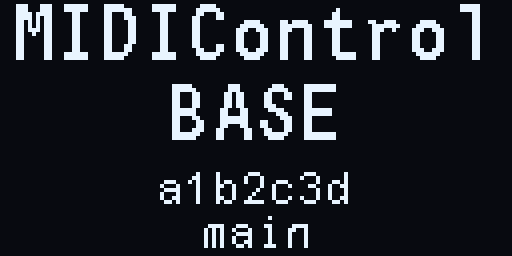

## Displej se uspí { #oled }

Po 30 sekundách bez ovládání se displej vypne (uspí). LED svítí dál.

1. Pohněte ovladačem nebo ho stiskněte. Displej se rozsvítí.
2. Další otočení či stisk už se provede normálně.

Pohyb nebo stisk, který displej probudil, se **neprovede**: slouží jen k probuzení.

Displej se rozsvítí i sám, když se stane něco, co máte vidět: objeví se nebo
zmizí obrazovka `Odpojeno`, začne přehrávání, skončí párování, běží aktualizace
nebo se nepodaří požadavek na počítač. Při otevřené stránce `Bluetooth` se
displej neuspí.

## LED { #led }

Šest LED na zadní straně ukazuje stav. Pořadí zleva doprava podle firmwaru:
`USB`, `Displej`, `Proud`, `MIDI A`, `MIDI B`, `Bluetooth`.

TODO: Jsou popisky LED na skříňce vytištěny a jak přesně znějí? Je pořadí
zleva doprava tak, jak je uvedeno (firmware zná jen pořadí 0 až 5)?

Jas je pevný (10 %). Zelená znamená „je připojeno / zapnuto“. Krátké bílé
zablikání (100 ms) znamená přenos dat.

| LED | Svítí zeleně, když | Bílé bliknutí | Zhasnuto |
|---|---|---|---|
| USB | PC komunikuje (poslední platný paket do 6 s). | Provoz USB-MIDI nebo komunikace s PC. | PC nekomunikuje. |
| Displej | Je připojena tabule. | Základna posílá tabuli data. | Tabule není připojena. |
| Proud | Napájení varhan je zapnuto. | Při každém zapnutí nebo vypnutí. | Napájení varhan je vypnuto. |
| MIDI A (vstup DIN) | Trvale **červená**, je-li zapnuto `Ident. MIDI`. | Každý přijatý bajt z DIN. | `Ident. MIDI` vypnuto. |
| MIDI B (výstup DIN) | Trvale **zelená**, je-li zapnuto `Ident. MIDI`. | Každý paket odeslaný na DIN. | `Ident. MIDI` vypnuto. |
| Bluetooth | Ovladač je připojen. | Přenos dat k ovladači. | Ovladač není připojen. |

Položka `LED` v nastavení je hlavní vypínač: po vypnutí zhasnou LED USB,
Displej, Proud a Bluetooth a přestanou blikat obě LED MIDI.

!!! note "Hlavní vypínač a LED MIDI"
    Po vypnutí `LED` zůstávají LED MIDI A (červená) a MIDI B (zelená) svítit, pokud je zapnuto
    `Ident. MIDI`. Chcete-li zhasnout všechny, vypněte obě položky.
    TODO: Je to záměr, nebo mají zhasnout všechny LED? (Firmware to dnes tak dělá.)

Čtyři přední LED jsou normálně zhasnuté. Rozsvítí se jen při neodstranitelné
chybě: třikrát červeně zablikají všechny čtyři a základna se restartuje.
Základna se pak sama vrátí do provozu. Opakuje-li se to, viz kapitolu
[Řešení problémů](problemy.md).

## Hlavní menu a nastavení { #menu }

Hlavní menu má nadpis `Hlavni menu`. Dokud základna nemá spárovaný ovladač,
je nadpis `Sparuj ovladac` (viz [Párování](#parovani-zakladna)).
V pravém horním rohu jsou stavové ikony: **monitor** = PC komunikuje,
**bezdrátová ikona** = ovladač je připojen (při přenosu dat krátce animovaná).

| Položka | Co dělá |
|---|---|
| `Prehraj` | Vyžádá seznam písní z PC a otevře ho (viz [Seznam písní](#seznam-pisni)). Bez PC se nic nestane. |
| `Nahraj` | Viz [Nahrávání](#nahravani). |
| `Nastaveni` | Otevře nastavení. |

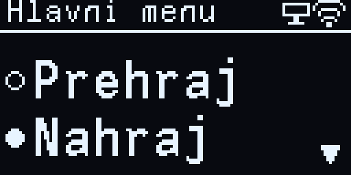
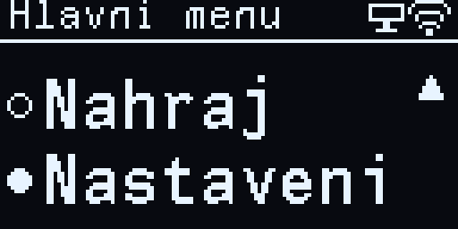

### Nastavení

Nadpis `Nastaveni`. Některé názvy se na displeji kvůli šířce zkracují; v
tabulce je napsáno, jak je uvidíte.

| Na displeji | Typ | Výchozí | Co dělá |
|---|---|---|---|
| `LED` | zaškrtávací | zapnuto | Hlavní vypínač zadních LED ([LED](#led)). Uloží se hned. |
| `Ident. MIDI` (vidíte `Ident. MI`) | zaškrtávací | zapnuto | Trvalé barvy LED MIDI A (červená) a MIDI B (zelená). Uloží se hned. |
| `Napajeni varhan` (vidíte `Napajeni`) | zaškrtávací | **vypnuto**, neukládá se | Zapne nebo vypne napájení varhan ([Napájení varhan](#varhany)). |
| `Verze FW` | stránka | | Verze firmwaru základny. |
| `Displej` | stránka | | Co základna ví o tabuli. |
| `Bluetooth` | stránka | | Stav bezdrátového spojení s ovladačem. |
| `Sparovat ovladac` (vidíte `Sparovat`) | akce | | Spustí párování ([Párování](#parovani-zakladna)). |
| `Zpet` | zpět | | Vrátí o jednu obrazovku zpět. |

TODO: Zkrácené názvy (`Ident. MI`, `Napajeni`, `Sparovat`) jsou na displeji
nepohodlné; při posunu se `Sparovat ovladac` zobrazí jako `at ovladac`.
Chcete názvy zkrátit ve firmwaru?

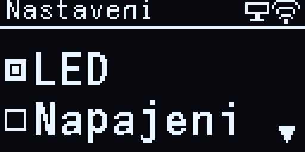
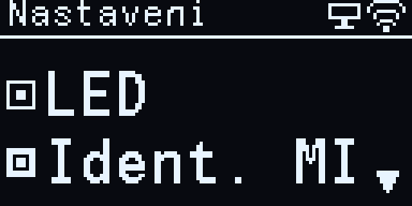
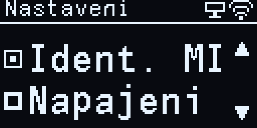

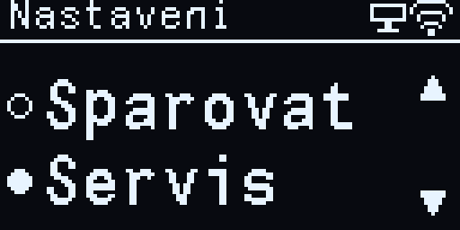
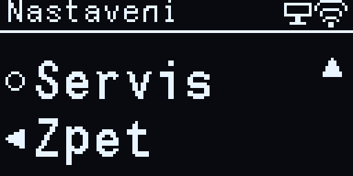

#### Změna zaškrtávací položky

1. Otočením ovladače vyberte položku (například `LED`).
2. Stiskněte ovladač. Políčko se přepne a nastavení se uloží, takže zůstane zachováno i po vypnutí.

Výjimka: `Napajeni varhan` se po vypnutí základny neuchová, viz [Napájení varhan](#varhany).

#### Stránky s informacemi

Stránky `Verze FW`, `Displej` a `Bluetooth` zavřete libovolným stiskem nebo
otočením ovladače; vrátí se `Nastaveni`.

`Verze FW` ukazuje čtyři řádky: `Revize:` (kód verze), `Vetev:`, `Datum:`
a `Cas:` (kdy byl firmware sestaven).

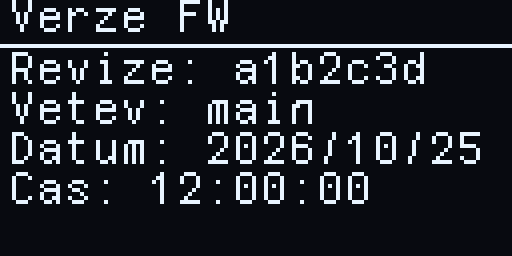

`Displej` ukazuje, co základna naposledy poslala tabuli nebo od ní přijala:
`Pripojen: Ano` nebo `Ne` (je tabule připojena), `Pisen: [..]` (číslice písně),
`Sloka: [..]`, `Pismeno: ..` a `LED: ..` (barva světla na tabuli:
`cervena`, `zelena`, `modra`, `zluta` nebo `vyp`).

`Bluetooth` ukazuje stav spojení s ovladačem:

| Řádek | Význam |
|---|---|
| `Modul: start...` | Bluetooth modul se spouští. |
| `Modul: OK` | Modul je v pořádku. |
| `Modul: OK, bez RST` | Modul je nastaven, ale restart se nepotvrdil. |
| `Modul: neodpovida` | Modul posílá data, ale neodpovídá na příkazy. |
| `Modul: mlci` | Modul nic neposílá. Jde o závadu hardwaru, kontaktujte správce. |
| `Spojeni: Ano` / `Ne` | Je navázáno bezdrátové spojení. |
| `Sparovano: Ano` / `Ne` | Ovladač je uznán jako spárovaný a zabezpečený. |
| `Ovladac: Ano` / `Ne` | Ovladač odpovídá. |
| `MAC: ...` | Adresa spárovaného ovladače (12 znaků), nebo `MAC: --`, když žádný není. |

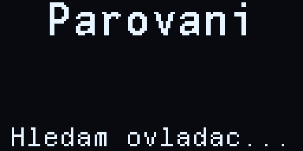

## Seznam písní { #seznam-pisni }

Píseň se obvykle vybírá na ovladači. Na základně ji lze vybrat takto
(vyžaduje komunikující PC):

1. V hlavním menu vyberte `Prehraj` a stiskněte ovladač.
   Zobrazí se `Pisne`. Trvá-li načtení déle než půl sekundy, ukáže se
   `Nacitani...` a `Cekam na PC`.
2. Otočením ovladače vyberte kód písně (například `406A`).
3. Stiskněte ovladač. Seznam se zavře a PC začne píseň hrát; zobrazí se
   obrazovka [Prehravam](#prehravani).

Seznam nabízí nejvýše 32 písní; delší názvy se zkrátí na 23 znaků. Při posunu
ke konci se načtou další. Poslední položka je `Zpet`.
TODO: Co má základna říci, když má PC písní víc než 32 (dnes se nic nezobrazí)?

Když PC neodpoví do 3 sekund, ukáže se `PC neodpovida`. Je-li složka prázdná,
ukáže se `Zadne pisne`. Obrazovku zavřete stiskem ovladače.

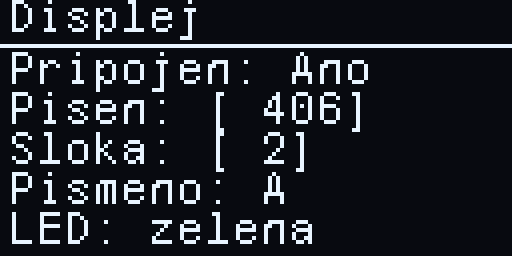
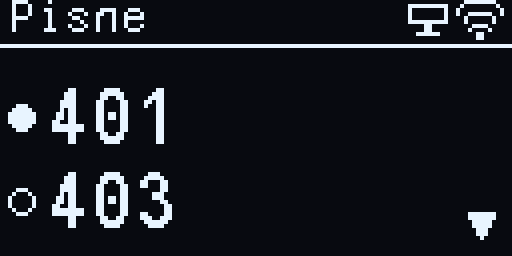

## Přehrávání { #prehravani }

Obrazovka `Prehravam` se otevře, když PC začne hrát (ať jste píseň vybrali
kdekoli). Ukazuje velký kód písně, řádek se slokou a tlačítko Stop.
Řádek se slokou je například `Sloka: 2`, `Sloka: 2 (x2)` (ještě dvě
opakování sloky) nebo `Predehra`.

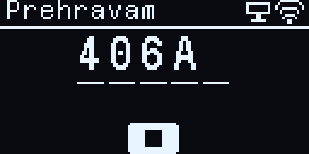
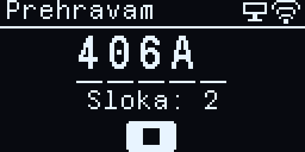
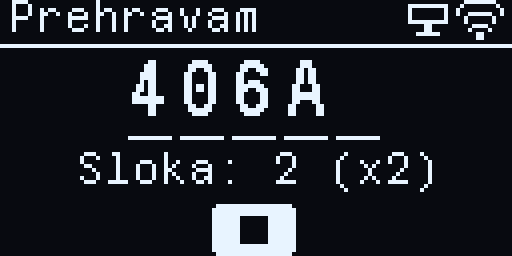

Na této obrazovce funguje jen stisk ovladače, otáčení nedělá nic.

1. Stiskněte ovladač. Nadpis se změní na `Zastavuji`.
2. Počkejte. PC píseň zastaví a ukáže se `Zastaveno` (asi 1,5 s),
   pak se obrazovka zavře.

Nepodaří-li se zastavení do 5 s, vrátí se `Prehravam` s příčinou na
informačním řádku a další stisk zkusí zastavení znovu.

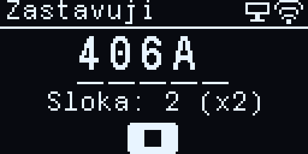
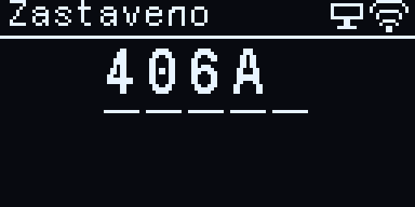

TODO: Specifikace SYSTEM.md (SYS-USE-24) počítá s volbou „Stop / Přidat sloku“
otočením ovladače. Základna to neumí, přidání sloky se dělá na ovladači nebo
příkazem `verse` na PC. Má příručka u základny něco slibovat?

### Chybové hlášky při požadavku na PC

Při neúspěšném požadavku se krátce ukáže jedna z těchto hlášek (na obrazovce
seznamu nebo na informačním řádku):

| Hláška | Význam |
|---|---|
| `PC neodpovida` | PC neodpovědělo ani po opakování. |
| `Neodeslano` | Požadavek se nepodařilo odeslat (fronta je plná). Zkuste znovu. |
| `Pisen nenalezena` | PC danou píseň nenašlo. |
| `PC zaneprazdneno` | PC je zrovna zaneprázdněno. Zkuste za chvíli. |
| `PC nedostupne` | Spojení k PC není. |
| `Nehraje se` | Pokus o zastavení, ale nic nehraje. |
| `Odmitnuto` | PC požadavek z jiného důvodu odmítlo. |

## Napájení varhan { #varhany }

Základna spíná napájení varhan. Stav ukazuje LED `Proud` (svítí zeleně = zapnuto).

Za běžného provozu napájení zapíná a vypíná PC samo (při přehrání písně
a po době nečinnosti). Ručně:

1. V `Nastaveni` vyberte `Napajeni varhan`.
2. Stiskněte ovladač. Políčko se zaškrtne a LED `Proud` se rozsvítí zeleně.
3. Dalším stiskem napájení vypnete.

Napájení se **neukládá**. Po vypnutí základny, restartu nebo výpadku proudu
je vždy vypnuto a políčko je prázdné. Je to záměr kvůli bezpečnosti.

Napájení se samo vypne, když:

- PC přestane komunikovat na 6 sekund (ukáže se `Odpojeno`; základna také
  vypne všechny znějící tóny);
- napájení je zapnuto a základna 2 hodiny nedostala od PC žádný paket
  (platí i při ručním zapnutí bez PC).

Program v PC navíc vypne varhany po 30 minutách nečinnosti, ale jen tehdy, když je při svém spuštění
našel už zapnuté (ručně zapnuté varhany přežijí start PC). Jinak řídí napájení PC podle písní.

TODO: Co říct varhaníkovi, který PC nepoužívá (platí jen limit 2 hodiny)?

## Párování ovladače { #parovani-zakladna }

Základna si pamatuje **jeden** ovladač. Nový ovladač nahradí předchozí.
Čerstvá základna bez ovladače má v hlavním menu nadpis `Sparuj ovladac`
a k ničemu se nepřipojuje, dokud ovladač nespárujete.

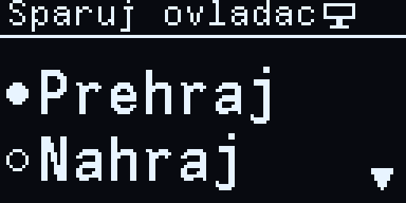

Příprava: oba přístroje zapnuté, blízko sebe. Párování se spouští na obou
stranách, ovladač má časové okno 60 s a základna hledání 15 s.

1. Na ovladači vyberte v nastavení `Sparovat zakl.`.
   Ovladač ukáže `Cekam na zakladnu` a odpočet `Zbyva 60 s`.
2. Na základně otevřete `Nastaveni` a vyberte `Sparovat ovladac`.
3. Stiskněte ovladač. Zobrazí se `Parovani` a `Hledam ovladac...`.
4. Počkejte. Po úspěchu se ukáže `Sparovano`; ovladač zobrazí `Sparovano`
   a adresu základny. Adresa ovladače se uloží do paměti základny
   (uvidíte ji na stránce `Bluetooth` jako `MAC:`).
5. Stiskem ovladače zavřete obrazovku. Ikona bezdrátového spojení se objeví
   v pravém horním rohu a rozsvítí se LED `Bluetooth`.

Možné výsledky kromě úspěchu:

| Hláška | Význam a postup |
|---|---|
| `Ovladac nenalezen` | Za 15 s se ovladač nenašel. Zkontrolujte, že ovladač čeká (krok 1), a opakujte. |
| `Parovani selhalo` | Ovladač se našel, ale párování se nedokončilo. Opakujte od kroku 1. |
| `BLE nefunguje` | Bluetooth modul základny neběží. Viz stránku `Bluetooth` a [Řešení problémů](problemy.md). |

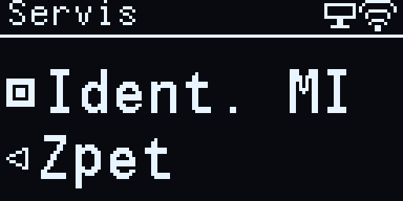

Stisk ovladače zavře obrazovku `Parovani`, párování samo dokončí nebo vyprší.
Po úspěšném párování se spojení krátce přeruší a samo se znovu naváže.
Spárovaná základna se k ovladači připojuje sama (každých 5 s), není třeba
nic dělat.

Postup na straně ovladače: kapitola [Ovladač](ovladac.md#parovani).

## Nahrávání { #nahravani }

V hlavním menu je položka `Nahraj`. **Zatím nic nedělá**: po stisku se
nic nestane a nic se nenahrává.

Nahrávání nové písně se dnes spouští na PC příkazem `record` v konzoli
(viz [Pro správce](sprava.md)). Základna při něm jen předává zahrané tóny
z DIN vstupu do PC přes USB-MIDI.

TODO: Bude se nahrávání spouštět z této položky (SYSTEM.md SYS-REC-01),
nebo má být položka z nabídky odstraněna? Až bude jasno, přepíšu tento oddíl.

## Co znamenají jednotlivé obrazovky { #obrazovky }

| Obrazovka | Kdy se ukáže a co znamená |
|---|---|
| `Hlavni menu` / `Sparuj ovladac` | Základní stav. Druhý nadpis: žádný ovladač není spárován. |
| `Odpojeno` | PC nekomunikuje. Obrazovka překrývá hlavní menu. |
| `Nastaveni`, stránky | Nastavení a informace, viz [výše](#menu). |
| `Pisne` | Seznam písní. |
| `Prehravam`, `Zastavuji`, `Zastaveno` | Přehrávání písně. |
| `Parovani` | Párování ovladače. |
| `Aktualizace` | Přenos firmwaru, viz [Aktualizace](#aktualizace). |

### Odpojeno

Text `Odpojeno` s hláškou `Cekam na PC` (bez spárovaného ovladače
`Sparuj ovladac`) a druhým řádkem `Stisk: Nastaveni`. Základna nevidí PC
(vypnuté, odpojený USB kabel, neběží služba). Všechno kromě nastavení
vyžaduje PC.

1. Stiskněte ovladač. Otevře se `Nastaveni` (napájení varhan a párování
   fungují i bez PC).
2. Po `Zpet` se vrátíte na `Odpojeno`. Jakmile se PC vrátí, obrazovka
   zmizí sama a objeví se hlavní menu s ikonou monitoru.

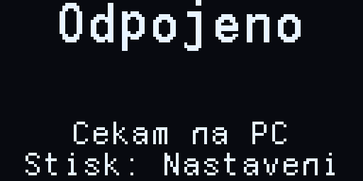
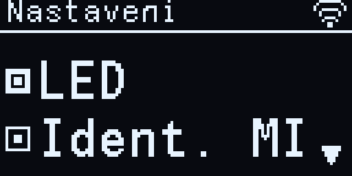
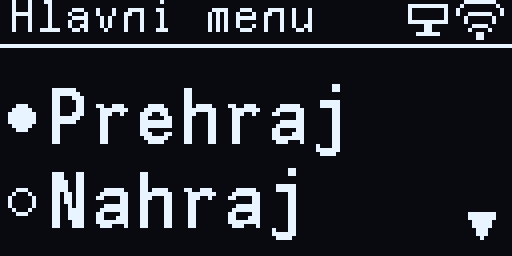
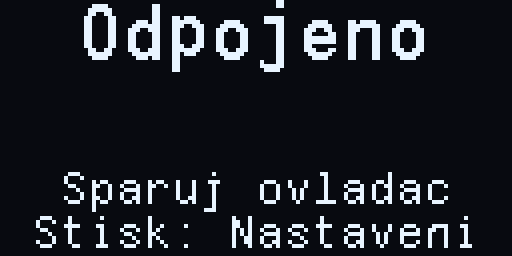

Nepřipojený ovladač poznáte podle chybějící bezdrátové ikony:

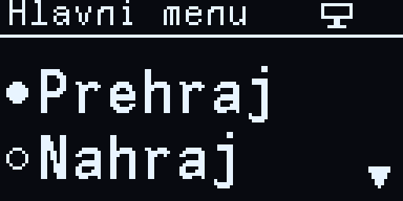

## Aktualizace firmwaru na základně { #aktualizace }

Firmware základny i ovladače se nahrává z PC, postup je v kapitole
[Webová stránka](web.md). Na základně uvidíte následující.

### Aktualizace ovladače přes základnu { #aktualizace-ovladace }

Obrazovka `Aktualizace` s ukazatelem průběhu a textem:

| Text | Význam |
|---|---|
| `Prenos do ovladace` | Firmware se posílá do ovladače. |
| `Instalace ovladace` | Ovladač firmware instaluje. |
| `Chyba aktualizace` | Aktualizace se nepodařila; opakujte ji. |

Během aktualizace základnu ani ovladač nevypínejte.

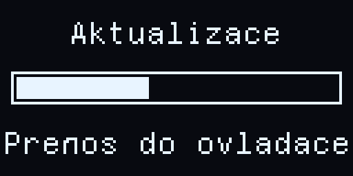

### Aktualizace základny { #aktualizace-zakladna }

Při aktualizaci základny se základna restartuje do zavaděče (bootloaderu)
a displej ukáže `Aktualizace`, ukazatel průběhu a řádek:

| Text | Význam |
|---|---|
| `Cekam na PC` | Zavaděč čeká na přenos. |
| `Nevypinejte` | Probíhá zápis, základnu nevypínejte (ani po 100 %). |
| `Chyba, opakujte` | Přenos selhal, nebo PC 20 s mlčí. Spusťte aktualizaci znovu. |

Po úplném a platném přenosu se základna sama restartuje do nového firmwaru.

!!! warning "Nevypínejte základnu"
    Při textu `Nevypinejte` základnu neodpojujte od napájení ani USB. Přerušený
    zápis může základnu vyřadit z provozu, dokud firmware nenahrajete znovu.

TODO: Platí tvrzení, že přerušená aktualizace nezničí základnu (je to pravda,
pokud zavaděč zůstane celý)? Ověřit u majitele.

#### Obnovení po neúspěšné aktualizaci

Základna se dá do zavaděče přinutit podržením tlačítka ovladače při zapnutí.

1. Odpojte základnu od napájení.
2. Stiskněte a držte ovladač.
3. Při držení základnu znovu zapněte. Základna se přihlásí jako zavaděč.
4. Z PC spusťte aktualizaci (soubor končící `-update.bin`).

TODO: Je tento postup určen uživatelům (obnovení), a jak ho popsat? Zavaděč
ho umí, ale není v specifikaci.

## Po výpadku proudu { #po-vypadku }

Po výpadku proudu a opětovném zapnutí:

1. Základna ukáže úvodní obrazovku a za 3 s hlavní menu. Pokud je PC
   vypnuté, ukáže se `Odpojeno`.
2. **Napájení varhan je vypnuto** (LED `Proud` nesvítí). Zapne ho PC při
   přehrání další písně, nebo ručně v `Nastaveni`.
3. Nastavení `LED` a `Ident. MIDI` a spárovaný ovladač zůstávají zachovány;
   párovat znovu není třeba.
4. Ovladač se připojí sám, obvykle do několika sekund. Rozehraná píseň se po výpadku
   neobnoví; vyberte ji znovu.

Stejně se základna chová i po restartu po chybě (třikrát červená přední LED).
Po takovém restartu základna navíc vypne všechny znějící tóny.
